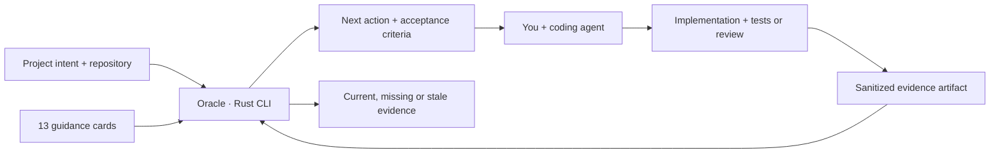

<p align="center">
  
</p>
<h1 align="center">Oracle</h1>
<p align="center"><strong>Build with intuition. Ship with evidence.</strong></p>
<p align="center">A local Rust CLI and agent skill for thoughtful software development.</p>
<p align="center"><a href="#get-started">Get started</a> · <a href="#what-oracle-does">Features</a> · <a href="docs/V1.md">Reference</a> · <a href="CONTRIBUTING.md">Contribute</a></p>

**v1.0.0 · MIT · Local and offline · No model API key required**

Oracle helps vibe coders and their coding agents answer a practical question: **what engineering decision matters next, and how will we know the result works?** It combines 13 versioned guidance cards, project context, repository inspection, and evidence tracking in a small native CLI.


## What Oracle does

| Common problem | Oracle's approach |
| --- | --- |
| The agent picks a stack without explaining it | Consider **Rust first for new services and tools**, then record ecosystem, delivery, deployment, and team trade-offs. Respect a justified existing stack. |
| An enterprise tool looks like a spacious landing page | Start with **compact, task-oriented UI**. Record audience, density, and workflow; review readability, keyboard use, target sizes, and real data. |
| Dependencies and build output inflate the repository | Inspect tracked generated paths, tracked working-tree size, large files, and local Git object storage. Keep local caches distinct from Git content. |
| Prototype work gets buried under process | **Prototype → beta → production** profiles introduce checks gradually. Assessment is advisory; blocking checks require `--strict`. |
| An agent says “done” without evidence | Record a sanitized artifact, outcome, and scope. Mark evidence stale after inspected project contents, artifacts, versions, or freshness change. |

Oracle guides projects written in other languages too. Rust preference is a starting point for a decision, not a requirement to rewrite working software. Compact interfaces still need accessible interaction. See the [Rust guidance](https://rust-lang.org/what/cli/), [Carbon density guidance](https://carbondesignsystem.com/components/data-table/usage/), and [WCAG target-size guidance](https://www.w3.org/WAI/WCAG22/Understanding/target-size-minimum.html) behind these choices.

## Get started

Install from this source checkout with [Rust](https://rust-lang.org/tools/install/) 1.85+ and Git:

```sh
git clone https://github.com/andersonbond/oracle.git
cd oracle
cargo install --path . --locked
oracle --version
```

The Cargo package is named `oracle-guide`; the executable is **`oracle`**. Use the source-install command above, not an unrelated package named `oracle`. Ensure Cargo's `bin` directory is on your PATH. No registry publication or prebuilt download is required for this route.

In the application you are building:

```sh
cd /path/to/your-project
oracle init --name my-app --kind web-app --audience enterprise
oracle agent install codex
oracle next
```

For Claude Code, use `oracle agent install claude`. The generic adapter uses the same `.agents/skills/oracle` location as Codex. Installation is project-local, repeatable, and refuses to overwrite conflicting or edited skill files. It leaves `AGENTS.md`, `CLAUDE.md`, and client settings untouched.

Open a fresh agent session in that project and ask:

> Use Oracle to review this project and help me address the most useful next action. Explain the trade-off before changing the architecture.

The adapters use the documented [Codex skill location](https://learn.chatgpt.com/docs/build-skills#where-codex-loads-local-skills) and [Claude Code project skill location](https://code.claude.com/docs/en/skills#choose-where-skills-load). Installation behavior is covered by automated tests; client discovery still depends on your installed client's settings and workspace trust.

## Start light. Add rigor when it matters.

| Stage | Active guidance |
| --- | --- |
| **Prototype** | Stack choice, UI intent, tracked-file hygiene and size, secret-candidate filenames |
| **Beta** | Add actual UX review, build/test evidence, relevant authorization and migration evidence, performance guidance |
| **Production** | Add applicable restore, deployment/recovery, and monitoring evidence |

Every assessment shows what is deferred or inapplicable. Even at production, `oracle check` is advisory. Use `oracle check --strict` when you want stage-appropriate required checks to affect an exit code. Add a rule ID to `policy.required` to activate and require it sooner.

Change the stage in `oracle.toml` when the project advances. This changes the project fingerprint, so review and re-record relevant evidence for the new scope.

## The project specification

`oracle init` creates a small, validated TOML file. Empty decisions stay unknown. For example:

```toml
schema_version = 1

[project]
name = "inventory-desk"
kind = "web-app"
stage = "prototype"
audience = "enterprise"

[stack]
prefer_rust = true
language = "Rust backend + TypeScript browser UI"
rationale = "Native service deployment; browser ecosystem for the operational UI."

[ux]
density = "compact"
primary_workflow = "Search stock, compare quantities, and update multiple rows."
rationale = "Desktop operators compare many records; keep keyboard access and readable controls."
```

See the [complete example](docs/examples/oracle.toml) and [configuration reference](docs/V1.md#configuration). A recorded stack or density decision is not proof that the architecture or screen is good; separate evidence cards address behavior and usability.

## Commands

| Command | Result |
| --- | --- |
| `oracle init` | Create context without overwriting existing configuration |
| `oracle assess` | Show all findings, scope, repository measurements, and evidence state |
| `oracle next --limit 3` | Prioritize unresolved active findings |
| `oracle explain UX-001` | Explain a rule, trade-offs, suggested action, and acceptance criteria |
| `oracle rules` | List the 13 bundled cards |
| `oracle check` | Assess without blocking development |
| `oracle check --strict` | Return a failing exit code for unresolved applicable required checks |
| `oracle agent install codex --dry-run` | Preview project-local skill installation |
| `oracle agent remove codex` | Remove matching installed files; preserve edits and unrelated files |
| `oracle evidence record …` | Append a versioned attestation with artifact hashes and a project fingerprint |

Use `--root /path/to/project` (or `-C`) to select a project and `--format json` for machine-readable output. Commands and options are described by `oracle --help` and subcommand help.

## Evidence that stays honest

Run your project's tests or review the relevant scenario using your normal tools. Save a minimal report under `.oracle/reports/`, including steps, environment, outcome, and limits. Then record the actual result:

```sh
oracle evidence record TEST-001 \
  --result pass --method report \
  --summary "Build and core behavior tests passed locally; external services were mocked" \
  --artifact .oracle/reports/build-and-tests.txt

oracle check --format json
```

The artifact must already exist. Use `--result fail` when the criterion failed, or `--method manual` for a human review. New records retain previous revisions locally.

| State | Meaning |
| --- | --- |
| `pass` | The bounded direct check passes, or a current supplied attestation reports success |
| `fail` | The direct criterion is unmet, or a current attestation reports failure |
| `unknown` | Context, coverage, or evidence is insufficient |
| `stale` | Previous evidence no longer matches current inputs, artifacts, versions, or age |
| `not_applicable` | The card does not apply to the declared kind/data |
| `deferred` | The current stage has not introduced this card |

**An attestation remains a claim.** Oracle checks provenance and freshness, not the semantic truth of a report. It does not run the tests, inspect screenshots for UX quality, certify security, or assign a misleading “production readiness” percentage.

## How it fits together



The core stays offline. Only explicit `init`, `agent install/remove`, and `evidence record` operations write project files. Assessments do not run project scripts, install dependencies, call model APIs, deploy, delete caches, or rewrite Git history.

Repository measurements cover Git-tracked and unignored working-tree files. Local `.oracle/` state and secret contents are excluded from the source fingerprint; attached artifacts are hashed separately. Git history, remote GitHub/LFS storage, ignored source, submodules, and unsafe/unreadable paths have documented coverage limits. See the [v1 reference](docs/V1.md#inspection-and-trust-boundaries).

## Development and scope

```sh
cargo fmt --all --check
cargo clippy --locked --all-targets -- -D warnings
cargo test --locked
cargo build --release --locked
```

The first implementation is validated locally on Apple Silicon macOS. CI is configured for Linux, macOS, Windows, and Rust 1.85 compatibility; a workflow configuration is not evidence that those remote jobs have already passed. The [validation record](docs/VALIDATION.md) lists what was actually exercised.

V1 provides general engineering guidance and bounded local checks. Database, security, performance, and operations cards accept supplied evidence; they are not live scanners or infrastructure integrations. Future improvements should follow real usage: sharper applicability, structured report importers, and more precise evidence invalidation. See the [original design record](docs/PROJECT_PLAN.md) for context.

Contribute concrete failure scenarios and evidence methods via [CONTRIBUTING.md](CONTRIBUTING.md). Report security concerns according to [SECURITY.md](SECURITY.md). Code, guidance, and bundled assets are provided under the [MIT License](LICENSE).
