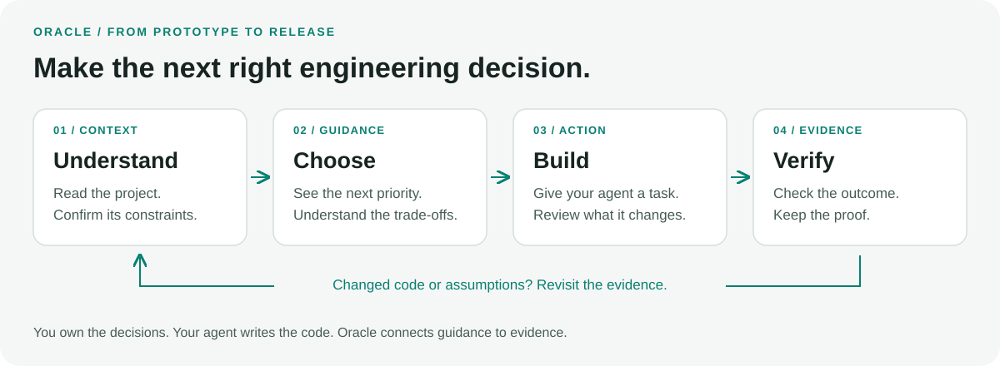
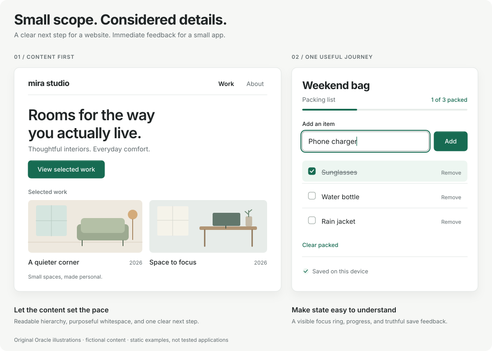
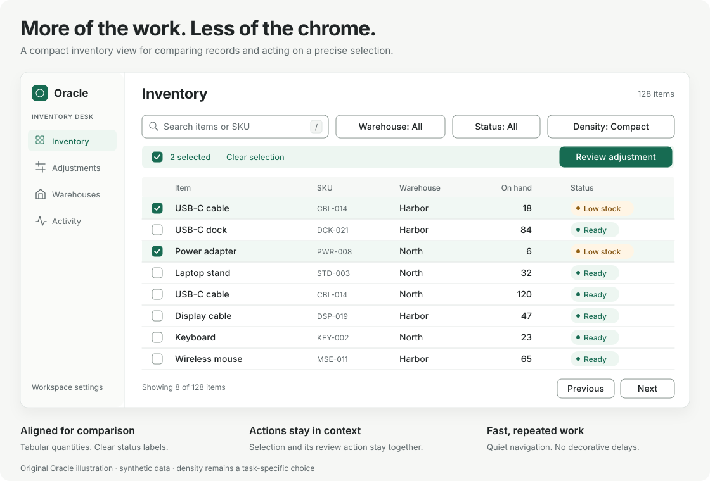
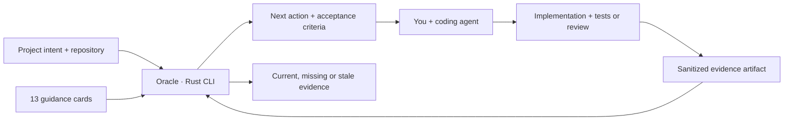

<p align="center">
  
</p>
<h1 align="center">Oracle</h1>
<p align="center"><strong>Build with intuition. Ship with evidence.</strong></p>
<p align="center">A local Rust CLI and agent skill for thoughtful software development.</p>
<p align="center"><a href="#get-started">Get started</a> · <a href="#what-oracle-does">Features</a> · <a href="REFERENCE.md">Reference</a> · <a href="CONTRIBUTING.md">Contribute</a></p>

**v1.0.8 · MIT · Local and offline · No model API key required**

Oracle helps vibe coders and their coding agents answer a practical question: **what engineering decision matters next, and how will we know the result works?** It combines 13 versioned guidance cards, project context, repository inspection, and evidence tracking in a small native CLI.



## What Oracle does

| Common problem | Oracle's approach |
| --- | --- |
| The agent picks a stack without explaining it | Consider **Rust first for new services and tools**: compile-time type and ownership checks catch many errors early, giving developers and coding agents concrete feedback. Memory-efficient native binaries and a consistent build, test, formatting, and linting toolchain support maintainable services. Weigh ecosystem, delivery, deployment, and team trade-offs; respect a justified existing stack. |
| An enterprise tool looks like a spacious landing page | For comparison and repeated operations, start with **compact, task-oriented UI**. Record audience, density, and workflow; review readability, keyboard use, target sizes, and real data. |
| A simple website or app gets overbuilt | Start with **clear content and one primary action**. Use responsive layouts and intentional whitespace; test the main journey. Add infrastructure only when a feature needs it. |
| An app needs live updates but loses state or exposes private events | Choose **WebSockets or Socket.IO when realtime behavior helps**; consider polling or SSE for simpler needs. Plan authorization, reconnect, missed updates, and delivery across servers. |
| Data becomes inconsistent or every slow page leads to another cache | Design **clear relationships and constraints**, normalize conflicting facts, and index actual queries. Bound database connections; add caching with measured benefit and an invalidation plan. Keep simple apps to one suitable database when sufficient. |
| Uploaded images consume storage unnecessarily | **Optimize display copies** of PNG, JPEG, and other supported images. Resize and compress for their use, measure the savings, and set quotas and cleanup policies. Let the user decide **whether and where to retain originals**. |
| Dependencies and build output inflate the repository | Inspect tracked generated paths, tracked working-tree size, large files, and local Git object storage. Keep local caches distinct from Git content. |
| Prototype work gets buried under process | **Prototype → beta → production** profiles introduce checks gradually. Assessment is advisory; blocking checks require `--strict`. |
| An agent says “done” without evidence | Record a sanitized artifact, outcome, and scope. Mark evidence stale after inspected project contents, artifacts, versions, or freshness change. |

Oracle guides projects written in other languages too. Rust preference is a starting point for a decision, not a requirement to rewrite working software or add a backend to a static site. See [Rust's performance, reliability, and tooling overview](https://rust-lang.org/) and the UI guides below.

## UI that fits the project

Oracle builds on [Emil Kowalski's Design Engineering skill](https://github.com/emilkowalski/skills/tree/main/skills/emil-design-eng) and UI cheatsheet for component craft, typography details, feedback, and purposeful motion. A pinned copy is bundled under its MIT license, with [source attribution and Oracle's integration guide](skills/oracle/references/ui-design.md). Oracle supplies the task and density context; agents can reuse the shared foundation instead of inventing a new UI rulebook.

**Simple websites and apps:** help someone understand the content or complete one useful task. A portfolio, local-business page, calculator, or personal tracker can use comfortable spacing, expressive visuals, and a small amount of navigation. Give each screen a clear purpose and make its main action work on small screens and with a keyboard. Start with the [simple-project guide and examples](skills/oracle/references/simple-projects.md).



**Enterprise workspaces:** bring the records and actions people need into view. Use clear alignment, readable text, a restrained toolbar, and details on demand. Start with the [compact UI guide](skills/oracle/references/compact-ui.md) when comparison and repeated operations are the primary task.



Choose the layout per screen: one product can have a spacious public page and a dense internal workspace. Audience alone does not determine complexity or density. See the [adaptive example](skills/oracle/assets/adaptive-workspace.svg) for a focused narrow view and a desktop editor with a recoverable save error. The upstream guidance, license, Oracle guides, and all three recreated SVGs are bundled for offline agent use. The illustrations contain fictional content and demonstrate design intent; actual interactions and motion still need testing. Frontend stacks remain a project choice, with no mandatory pixel budgets.

## Realtime when the feature needs it

Chat, collaboration, presence, and live status can benefit from persistent connections. The [realtime guide](skills/oracle/references/realtime.md) compares polling, SSE, native WebSockets, and Socket.IO; covers Rust candidates such as Axum and Socketioxide; and explains authorization, recovery, and scaling trade-offs.

Socket.IO uses its own protocol over its transports, so pair it with compatible clients and servers. Automatic reconnect does not guarantee recovery of every missed update. Start with the [shared task-board specification](examples/realtime/oracle.toml), then test the application's actual behavior. The guide is bundled for offline agent use; Oracle itself does not run a realtime service or add networking dependencies to your app.

## Data that stays manageable

The [database guide](skills/oracle/references/database.md) covers five decisions, with a relationship diagram and practical examples:

| Decision | Lightweight starting point |
| --- | --- |
| Database design | Model the main reads, writes, ownership, and constraints in a small schema |
| Normalization | Keep each fact in the right place; preserve intentional historical snapshots |
| Indexing | Support actual queries and verify the plan instead of indexing every column |
| Connection pooling | Share bounded connections where needed; budget across processes |
| Caching | Start without an application data cache; define freshness and invalidation when measurements justify one |

A small app can use SQLite or an existing suitable database without adding Redis, a separate pooler, or replicas. See the [small reading-list specification](examples/simple-data/oracle.toml). The guide is bundled for offline agent use and expands the existing database and performance cards; Oracle does not connect to your database or add new required gates.

## Image uploads that stay manageable

Use an image optimizer for uploaded photos, avatars, screenshots, and product images. Serve appropriately sized copies and keep only the variants the app needs. The [image-upload guide](skills/oracle/references/image-uploads.md) covers Rust and existing-stack options, quality checks, upload limits, and cleanup.

**Original storage is the user's choice:** keep originals on their device, retain them in private application storage, or use an approved object store/archive. Make retention and deletion explicit. Optimization and storage quotas work together; keeping originals and every generated variant can still grow storage. Simple apps can use one processing step and existing suitable storage.

## Get started

Install from this source checkout with [Rust](https://rust-lang.org/tools/install/) 1.85+ and Git:

```sh
git clone https://github.com/andersonbond/oracle.git
cd oracle
cargo install --path . --locked
oracle --version
```

The Cargo package is named `oracle-guide`; the executable is **`oracle`**. Use the source-install command above, not an unrelated package named `oracle`. Ensure Cargo's `bin` directory is on your PATH. No registry publication or prebuilt download is required for this route.

In the application you are building:

```sh
cd /path/to/your-project
oracle init --name my-app --kind web-app --audience consumer
oracle agent install codex
oracle next
```

Choose the actual audience: `consumer`, `enterprise`, or `developer`. In v1, `web-app` also covers static websites; it does not require a server or database. The [simple-site specification](examples/simple-site/oracle.toml) shows a small starting point. Record the actual deployment stage as the project advances; simple projects can be production projects too.

For Claude Code, use `oracle agent install claude`. The generic adapter uses the same `.agents/skills/oracle` location as Codex. Installation is project-local, repeatable, and refuses to overwrite conflicting or edited skill files. It leaves `AGENTS.md`, `CLAUDE.md`, and client settings untouched.

Open a fresh agent session in that project and ask:

> Use Oracle to review this project and help me address the most useful next action. Explain the trade-off before changing the architecture.

The adapters use the documented [Codex skill location](https://learn.chatgpt.com/docs/build-skills#where-codex-loads-local-skills) and [Claude Code project skill location](https://code.claude.com/docs/en/skills#choose-where-skills-load). Installation behavior is covered by automated tests; client discovery still depends on your installed client's settings and workspace trust.

To check an agent's actual behavior, use the optional [live-agent trials](CONTRIBUTING.md#live-agent-trials) for a simple app and an inventory workspace. They separate skill discovery, reference reading, and independent checks of the generated app; installation alone does not prove that guidance was followed.

### Use the UI guides directly

For UI work, `oracle agent install codex` (or `claude`) works without `oracle init`. If you only want the guides and do not have the binary, copy the complete `skills/oracle/` directory from this checkout into the relevant project skill location above, preserving references, images, and the upstream license. Do not overwrite an existing customized skill; follow the [update instructions](REFERENCE.md#agent-installation-and-updates).

Agents discover the `oracle` skill from its name and description, then follow `SKILL.md` to [UI that fits the project](skills/oracle/references/ui-design.md). The copied Emil reference is loaded through that guide, not invoked as a separate installed skill. UI guidance is available even when no UX action appears in `oracle next`.

To choose Oracle explicitly in Codex CLI/IDE, mention `$oracle` or select it from `/skills`; in Claude Code, use `/oracle`, followed by the task. For example:

- “Use Oracle to refine this personal tracker. Keep it simple and make input, save, and error states clear.”
- “Use Oracle to improve this inventory workspace for comparing records and batch actions. Preserve keyboard access.”

For a generic agent, ask it to read the installed `.agents/skills/oracle/SKILL.md` and follow the UI route; automatic discovery depends on the host. Review the actual screen's task: enterprise public pages can be comfortable, while a consumer comparison tool can be compact.

## Start light. Add rigor when it matters.

| Stage | Active guidance |
| --- | --- |
| **Prototype** | Stack choice, UI intent, tracked-file hygiene and size, secret-candidate filenames |
| **Beta** | Add actual UX review, build/test evidence, relevant authorization and migration evidence, performance guidance |
| **Production** | Add applicable restore, deployment/recovery, and monitoring evidence |

Every assessment shows what is deferred or inapplicable. Even at production, `oracle check` is advisory. Use `oracle check --strict` when you want stage-appropriate required checks to affect an exit code. Add a rule ID to `policy.required` to activate and require it sooner.

Change the stage in `oracle.toml` when the project advances. This changes the project fingerprint, so review and re-record relevant evidence for the new scope.

## The project specification

`oracle init` creates a small, validated TOML file. Empty decisions stay unknown. For example:

```toml
schema_version = 1

[project]
name = "inventory-desk"
kind = "web-app"
stage = "prototype"
audience = "enterprise"

[stack]
prefer_rust = true
language = "Rust backend + TypeScript browser UI"
rationale = "Native service deployment; browser ecosystem for the operational UI."

[ux]
density = "compact"
primary_workflow = "Search stock, compare quantities, and update multiple rows."
rationale = "Desktop operators compare many records; keep keyboard access and readable controls."
```

See the [enterprise example](examples/oracle.toml), [simple-site example](examples/simple-site/oracle.toml), [realtime example](examples/realtime/oracle.toml), [small database app](examples/simple-data/oracle.toml), and [configuration reference](REFERENCE.md#configuration). A recorded stack or density decision is not proof that the architecture or screen is good; separate evidence cards address behavior and usability.

## Commands

| Command | Result |
| --- | --- |
| `oracle init` | Create context without overwriting existing configuration |
| `oracle assess` | Show all findings, scope, repository measurements, and evidence state |
| `oracle next --limit 3` | Prioritize unresolved active findings |
| `oracle explain UX-001` | Explain a rule, trade-offs, suggested action, and acceptance criteria |
| `oracle rules` | List the 13 bundled cards |
| `oracle check` | Assess without blocking development |
| `oracle check --strict` | Return a failing exit code for unresolved applicable required checks |
| `oracle agent install codex --dry-run` | Preview project-local skill installation |
| `oracle agent remove codex` | Remove matching installed files; preserve edits and unrelated files |
| `oracle evidence record …` | Append a versioned attestation with artifact hashes and a project fingerprint |

Use `--root /path/to/project` (or `-C`) to select a project and `--format json` for machine-readable output. Commands and options are described by `oracle --help` and subcommand help.

## Evidence that stays honest

Run your project's tests or review the relevant scenario using your normal tools. Save a minimal report under `.oracle/reports/`, including steps, environment, outcome, and limits. Then record the actual result:

```sh
oracle evidence record TEST-001 \
  --result pass --method report \
  --summary "Build and core behavior tests passed locally; external services were mocked" \
  --artifact .oracle/reports/build-and-tests.txt

oracle check --format json
```

The artifact must already exist. Use `--result fail` when the criterion failed, or `--method manual` for a human review. New records retain previous revisions locally.

| State | Meaning |
| --- | --- |
| `pass` | The bounded direct check passes, or a current supplied attestation reports success |
| `fail` | The direct criterion is unmet, or a current attestation reports failure |
| `unknown` | Context, coverage, or evidence is insufficient |
| `stale` | Previous evidence no longer matches current inputs, artifacts, versions, or age |
| `not_applicable` | The card does not apply to the declared kind/data |
| `deferred` | The current stage has not introduced this card |

**An attestation remains a claim.** Oracle checks provenance and freshness, not the semantic truth of a report. It does not run the tests, inspect screenshots for UX quality, certify security, or assign a misleading “production readiness” percentage.

## How it fits together



The core stays offline. Only explicit `init`, `agent install/remove`, and `evidence record` operations write project files. Assessments do not run project scripts, install dependencies, call model APIs, deploy, delete caches, or rewrite Git history.

Repository measurements cover Git-tracked and unignored working-tree files. Local `.oracle/` state and secret contents are excluded from the source fingerprint; attached artifacts are hashed separately. Git history, remote GitHub/LFS storage, ignored source, submodules, and unsafe/unreadable paths have documented coverage limits. See the [v1 reference](REFERENCE.md#inspection-and-trust-boundaries).

## Development and scope

```sh
cargo fmt --all --check
cargo clippy --locked --all-targets -- -D warnings
cargo test --locked
cargo build --release --locked
```

CI runs behavioral tests and release builds on Linux, macOS, and Windows, including a Rust 1.85 compatibility job. Stable-toolchain jobs also check formatting and linting. See the [workflow and current run results](https://github.com/andersonbond/oracle/actions/workflows/ci.yml) for each revision.

V1 provides general engineering guidance and bounded local checks. Database, security, performance, and operations cards accept supplied evidence; they are not live scanners or infrastructure integrations. Future improvements should follow real usage: sharper applicability, structured report importers, and more precise evidence invalidation.

Contribute concrete failure scenarios and evidence methods via [CONTRIBUTING.md](CONTRIBUTING.md). Report security concerns according to [SECURITY.md](SECURITY.md). Code, guidance, and bundled assets are provided under the [MIT License](LICENSE).
