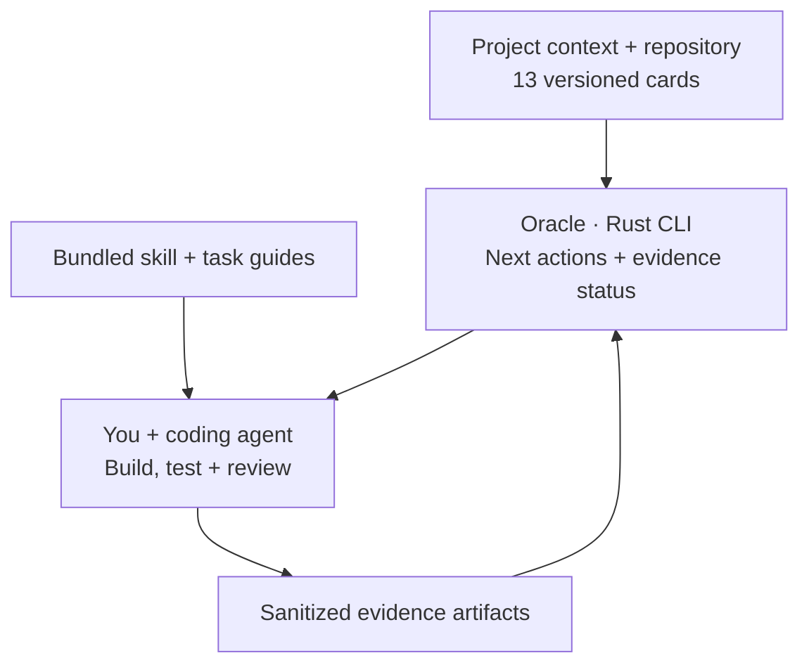

<p align="center">
  
</p>
<h1 align="center">Oracle</h1>
<p align="center"><strong>Build with intuition. Ship with evidence.</strong></p>
<p align="center">A local Rust CLI and agent skill for thoughtful software development.</p>
<p align="center"><a href="#get-started">Get started</a> · <a href="#what-oracle-does">Features</a> · <a href="#use-the-guides-directly">Agent guidance</a> · <a href="REFERENCE.md">Reference</a> · <a href="CHANGELOG.md">Changelog</a> · <a href="CONTRIBUTING.md">Contribute</a></p>

**v1.0.11 · MIT · Local and offline · No model API key required**

Oracle helps vibe coders and their coding agents answer a practical question: **what engineering decision matters next, and how will we know the result works?** Use it for a simple website, a small app, or an enterprise workspace, from prototype to a dependable release.

- **Give your coding agent useful guidance:** a portable skill with UI examples and security, realtime, database, caching, image-upload, and containerization references. Use the guides directly, without a project specification or CLI assessment.
- **Track decisions and evidence when needed:** a small Rust CLI combines 13 versioned cards, an `oracle.toml` specification, repository inspection, and evidence tracking. Checks grow with the project's stage and actual features.

Oracle itself runs locally and offline; model access is handled by your coding agent.


## What Oracle does

| Common problem | Oracle's approach |
| --- | --- |
| The agent picks a stack without explaining it | Consider **Rust first for new services and tools**: compile-time type and ownership checks catch many errors early, giving developers and coding agents concrete feedback. Memory-efficient native binaries and a consistent build, test, formatting, and linting toolchain support maintainable services. Weigh ecosystem, delivery, deployment, and team trade-offs; respect a justified existing stack. |
| An enterprise tool looks like a spacious landing page | For comparison and repeated operations, start with **compact, task-oriented UI**. Record audience, density, and workflow; review readability, keyboard use, target sizes, and real data. |
| A simple website or app gets overbuilt | Start with **clear content and one primary action**. Use responsive layouts and intentional whitespace; test the main journey. Add infrastructure only when a feature needs it. |
| An app needs live updates but loses state or exposes private events | Choose **WebSockets or Socket.IO when realtime behavior helps**; consider polling or SSE for simpler needs. Plan authorization, reconnect, missed updates, and delivery across servers. |
| Data becomes inconsistent or every slow page leads to another cache | Design **clear relationships and constraints**, normalize conflicting facts, and index actual queries. Bound database connections; add caching with measured benefit and an invalidation plan. Keep simple apps to one suitable database when sufficient. |
| Cached pages show old data, leak private results, or overload the database when Redis fails | Choose the **right caching layer**, define freshness and access scope, and test invalidation and outages. Use HTTP caching for suitable public content; add an application cache only when useful. |
| Uploaded images consume storage unnecessarily | **Optimize display copies** of PNG, JPEG, and other supported images. Resize and compress for their use, measure the savings, and set quotas and cleanup policies. Let the user decide **whether and where to retain originals**. |
| Sign-in works, but private data is still exposed | Apply **security that fits the feature**: protect secrets, enforce server permissions, handle untrusted input, and verify both allowed and denied access. Include private files, exports, caches, and realtime events when present. |
| A container builds locally but fails elsewhere or loses data | Verify the **runtime, architecture, final image, and durable storage**. Use Docker Desktop, Colima, or Linux Engine deliberately; test real behavior and recovery. Keep native/static deployment when sufficient. |
| Dependencies and build output inflate the repository | Inspect tracked generated paths, tracked working-tree size, large files, and local Git object storage. Keep local caches distinct from Git content. |
| Prototype work gets buried under process | **Prototype → beta → production** profiles introduce checks gradually. Assessment is advisory; blocking checks require `--strict`. |
| An agent says “done” without evidence | Record a sanitized artifact, outcome, and scope. Mark evidence stale after inspected project contents, artifacts, versions, or freshness change. |

Oracle guides projects written in other languages too. Rust preference is a starting point for a decision, not a requirement to rewrite working software or add a backend to a static site. See [Rust's performance, reliability, and tooling overview](https://rust-lang.org/) and the UI guides below.

## UI that fits the project

Oracle builds on [Emil Kowalski's Design Engineering skill](https://github.com/emilkowalski/skills/tree/main/skills/emil-design-eng) and UI cheatsheet for component craft, typography details, feedback, and purposeful motion. A pinned copy is bundled under its MIT license, with [source attribution and Oracle's integration guide](skills/oracle/references/ui-design.md). Oracle supplies the task and density context; agents can reuse the shared foundation instead of inventing a new UI rulebook.

**Simple websites and apps:** help someone understand the content or complete one useful task. A portfolio, local-business page, calculator, or personal tracker can use comfortable spacing, expressive visuals, and a small amount of navigation. Give each screen a clear purpose and make its main action work on small screens and with a keyboard. Start with the [simple-project guide and examples](skills/oracle/references/simple-projects.md).


**Enterprise workspaces:** bring the records and actions people need into view. Use clear alignment, readable text, a restrained toolbar, and details on demand. Start with the [compact UI guide](skills/oracle/references/compact-ui.md) when comparison and repeated operations are the primary task.


Choose the layout per screen: one product can have a spacious public page and a dense internal workspace. Audience alone does not determine complexity or density. See the [adaptive example](skills/oracle/assets/adaptive-workspace.svg) for a focused narrow view and a desktop editor with a recoverable save error. The upstream guidance, license, Oracle guides, and all three recreated SVGs are bundled for offline agent use. The illustrations contain fictional content and demonstrate design intent; actual interactions and motion still need testing. Frontend stacks remain a project choice, with no mandatory pixel budgets.

Review the whole screen with realistic content: headings and toolbars should leave room for the main task. Check repeated keyboard actions, focus after rows or controls update, and essential actions on a phone. The [shared UI guide](skills/oracle/references/ui-design.md) connects these checks to the bundled UI cheatsheet and relevant Design Engineering sections.

## Realtime when the feature needs it

Chat, collaboration, presence, and live status can benefit from persistent connections. The [realtime guide](skills/oracle/references/realtime.md) compares polling, SSE, native WebSockets, and Socket.IO; covers Rust candidates such as Axum and Socketioxide; and explains authorization, recovery, and scaling trade-offs.

Socket.IO uses its own protocol over its transports, so pair it with compatible clients and servers. Automatic reconnect does not guarantee recovery of every missed update. Start with the [shared task-board specification](examples/realtime/oracle.toml), then test the application's actual behavior. The guide is bundled for offline agent use; Oracle itself does not run a realtime service or add networking dependencies to your app.

## Data that stays manageable

The [database guide](skills/oracle/references/database.md) covers five decisions, with a relationship diagram and practical examples:

| Decision | Lightweight starting point |
| --- | --- |
| Database design | Model the main reads, writes, ownership, and constraints in a small schema |
| Normalization | Keep each fact in the right place; preserve intentional historical snapshots |
| Indexing | Support actual queries and verify the plan instead of indexing every column |
| Connection pooling | Share bounded connections where needed; budget across processes |
| Caching | Start without an application data cache; define freshness and invalidation when measurements justify one |

A small app can use SQLite or an existing suitable database without adding Redis, a separate pooler, or replicas. See the [small reading-list specification](examples/simple-data/oracle.toml). The guide is bundled for offline agent use and expands the existing database and performance cards; Oracle does not connect to your database or add new required gates.

## Caching that fits the project

The [caching guide](skills/oracle/references/caching.md) covers browser/CDN policies, cached UI data, in-process Rust caches, and **Redis as an optional shared cache**. Start from measured expensive work and the acceptable age of each result. Define access scope, expiry, update/delete invalidation, memory limits, and behavior when the cache is unavailable. A small app can keep one suitable database and no application cache.

The guide includes public-asset HTTP examples and a [standalone Rust/Redis example](skills/oracle/assets/caching/main.rs), with a [Compose recipe](skills/oracle/assets/caching/compose.yaml) and [verification helper](skills/oracle/assets/caching/verify.py) for Docker or Colima's Docker runtime. It exercises hits, misses, expiry, invalidation, startup failure, a live Redis outage, and a fresh client after restart. The origin is a synthetic in-memory fixture; its timings do not establish application performance, concurrency safety, or private-data authorization.

All example resources ship with the offline agent skill. The guide works without an active performance finding; running examples is a separate action. Redis remains optional, and Oracle itself gains no Redis dependency, new configuration fields, or mandatory cache checks. See [caching example validation](CONTRIBUTING.md#caching-examples) for native and container requirements.

## Image uploads that stay manageable

Use an image optimizer for uploaded photos, avatars, screenshots, and product images. Serve appropriately sized copies and keep only the variants the app needs. The [image-upload guide](skills/oracle/references/image-uploads.md) covers Rust candidates such as `image` and `oxipng`, `sharp` for existing Node.js apps, and the trade-offs in quality, formats, processing limits, and cleanup. Measure the result: an already optimized image may not get smaller.

**Original storage is the user's choice:** keep originals on their device, retain them in private application storage, or use an approved object store/archive. Make retention and deletion explicit. Optimization and storage quotas work together; keeping originals and every generated variant can still grow storage. Simple apps can use one processing step and existing suitable storage.

Preserve the source bytes before client-side compression when originals must be retained. Apply the intended access policy to originals and display copies, including thumbnails. Explain the chosen retention policy in the UI; offer individual storage choices only when the project supports them. Show useful progress and recoverable errors, and report success only after the required copies are stored.

## Security that fits the project

The [security guide](skills/oracle/references/security.md) connects common mistakes to implementation choices and observable checks. It covers secrets, authentication and sessions, server authorization, untrusted input, dependencies, deployment, and safe coding-agent use. It builds on OWASP sources and links to the existing upload, realtime, and database guides, with a small diagram showing where client requests become authorized operations.

A static site starts with published content, dependencies, hosting access, and HTTPS. Accounts and private data add session and permission checks; tenant and privileged workflows add their corresponding boundaries. Apply relevant protections before exposing a feature, even in a prototype. For example:

> User A can use their private record. User B cannot read, change, export, or subscribe to it by changing the record ID or calling the API directly.

The guide works offline without initialization or an active security finding. Use existing evidence cards when tracking is useful. `SEC-001` is a bounded filename check; `SEC-002` records supplied authorization evidence. Neither is a complete security assessment, and this guide adds no scanner, configuration fields, or mandatory gates.

## Containerization that fits the project

The [containerization guide](skills/oracle/references/containerization.md) covers **Docker Desktop, Colima with the Docker runtime, and Linux Docker Engine**. It separates client tools, engine contexts, and macOS VMs, with checks for Apple Silicon targets, Compose/Buildx availability, shared paths, and persistent storage. Colima's containerd runtime needs its own compatible tooling.

Start with the [multi-stage Rust Dockerfile](skills/oracle/assets/containerization/Dockerfile), its [build-context ignore file](skills/oracle/assets/containerization/Dockerfile.dockerignore), and the [Compose example](skills/oracle/assets/containerization/compose.yaml). They package Oracle's actual CLI, demonstrate non-root execution and a persisted project mount, and ship with the offline skill. Run them from an Oracle source checkout using the guide's commands. The guide also covers secrets, service readiness, graceful shutdown, backups, and deployment recovery; the one-shot CLI example does not demonstrate every service concern.

Use containers when they solve a concrete packaging or deployment need. A native Rust binary or static host remains a valid choice. Oracle runs without a container engine and does not start VMs or deploy applications. See [optional container validation](CONTRIBUTING.md#container-examples) for checks against a selected local engine, including Colima.

## Get started

### Install the CLI

Install from this source checkout with [Rust](https://rust-lang.org/tools/install/) 1.85+ and Git:

```sh
git clone https://github.com/andersonbond/oracle.git
cd oracle
cargo install --path . --locked
oracle --version
```

The Cargo package is named `oracle-guide`; the executable is **`oracle`**. Use the source-install command above, not an unrelated package named `oracle`. Ensure Cargo's `bin` directory is on your PATH. No registry publication or prebuilt download is required for this route.

### Add guidance to your agent

From the application you are building, install the bundled skill:

```sh
cd /path/to/your-project
oracle agent install codex
```

| Agent | Install command | Project-local skill directory |
| --- | --- | --- |
| Codex | `oracle agent install codex` | `.agents/skills/oracle/` |
| Claude Code | `oracle agent install claude` | `.claude/skills/oracle/` |
| Generic agent | `oracle agent install generic` | `.agents/skills/oracle/` |

Installation needs an existing project directory, but no Git repository or `oracle.toml`. It is repeatable and refuses to overwrite conflicting or edited skill files. It leaves `AGENTS.md`, `CLAUDE.md`, and client settings untouched. When upgrading, follow the [skill update instructions](REFERENCE.md#agent-installation-and-updates) to preserve customizations and replace an older bundle.

Open a fresh agent session in that project and ask:

> Use Oracle to review this screen's layout and interaction states. Keep the changes proportional to the task.

The adapters use the documented [Codex skill location](https://learn.chatgpt.com/docs/build-skills#where-codex-loads-local-skills) and [Claude Code project skill location](https://code.claude.com/docs/en/skills#choose-where-skills-load). Installation behavior is covered by automated tests; client discovery still depends on your installed client's settings and workspace trust.

To check an agent's actual behavior, use the optional [live-agent trials](CONTRIBUTING.md#live-agent-trials) for a simple app and an inventory workspace. They separate skill discovery, reference reading, and independent checks of the generated app; installation alone does not prove that guidance was followed.

### Use the guides directly

If you only want the guides and do not have the binary, clone this repository and copy the complete `skills/oracle/` directory into the relevant project skill location above. This route needs no Rust toolchain. Preserve references, images, and the upstream license; review and merge any existing customizations instead of overwriting them.

The [`SKILL.md` entrypoint](skills/oracle/SKILL.md) routes the agent to references relevant to the task. UI work follows [UI that fits the project](skills/oracle/references/ui-design.md), one applicable layout guide, the UI cheatsheet, and relevant Design Engineering sections. Security, realtime, database, caching, image-upload, and containerization work have their own linked guides. The copied Emil reference is supporting material within Oracle's skill. Guides remain available even when `oracle next` has no related finding; that command lists unresolved active cards, not every available reference.

To choose Oracle explicitly in Codex CLI/IDE, mention `$oracle` or select it from `/skills`; in Claude Code, use `/oracle`, followed by the task. For example:

- “Use Oracle to refine this personal tracker. Keep it simple and make input, save, and error states clear.”
- “Use Oracle to improve this inventory workspace for comparing records and batch actions. Preserve keyboard access.”
- “Use Oracle to package this Rust service for Colima locally and Linux in production. Verify runtime dependencies and preserve application data.”
- “Use Oracle to choose realtime delivery for this task board and plan reconnect recovery.”
- “Use Oracle to review this small app's schema, indexes, and connection usage before adding a cache.”
- “Use Oracle to assess caching for this slow dashboard. Compare HTTP, local, and Redis options, then test freshness and cache outages.”
- “Use Oracle to add image uploads with optimized display copies. Help me decide whether and where to keep originals.”
- “Use Oracle to review access to private records and uploads. Test legitimate access and attempts by another user.”

For a generic agent, ask it to read the installed `.agents/skills/oracle/SKILL.md` and follow the relevant task guidance; automatic discovery depends on the host. The guides inform implementation choices. Oracle does not install an application framework, database, realtime service, or image optimizer for you.

### Track decisions and release evidence

When you want project assessment as well as guidance, initialize the specification and review the next actions:

```sh
oracle init --name my-app --kind web-app --audience consumer
oracle next
```

Choose the actual audience: `consumer`, `enterprise`, or `developer`. Review `oracle.toml`, record known stack and UI decisions, and declare database and private-record features when present. In v1, `web-app` also covers static websites; it does not require a server or database. The [simple-site specification](examples/simple-site/oracle.toml) shows a small starting point. Record the actual deployment stage as the project advances; simple projects can be production projects too.

## Start light. Add rigor when it matters.

| Stage | Active guidance |
| --- | --- |
| **Prototype** | Stack choice, UI intent, tracked-file hygiene and size, secret-candidate filenames |
| **Beta** | Add actual UX review, build/test evidence, relevant authorization and migration evidence, performance guidance |
| **Production** | Add applicable restore, deployment/recovery, and monitoring evidence |

Every assessment shows what is deferred or inapplicable. Even at production, `oracle check` is advisory. Use `oracle check --strict` when you want stage-appropriate required checks to affect an exit code. Add a rule ID to `policy.required` to activate and require it sooner.

Change the stage in `oracle.toml` when the project advances. This changes the project fingerprint, so review and re-record relevant evidence for the new scope.

## The project specification

`oracle init` creates a small, validated TOML file. Empty decisions stay unknown. For example:

```toml
schema_version = 1

[project]
name = "inventory-desk"
kind = "web-app"
stage = "prototype"
audience = "enterprise"

[stack]
prefer_rust = true
language = "Rust backend + TypeScript browser UI"
rationale = "Native service deployment; browser ecosystem for the operational UI."

[ux]
density = "compact"
primary_workflow = "Search stock, compare quantities, and update multiple rows."
rationale = "Desktop operators compare many records; keep keyboard access and readable controls."
```

See the [enterprise example](examples/oracle.toml), [simple-site example](examples/simple-site/oracle.toml), [realtime example](examples/realtime/oracle.toml), [small database app](examples/simple-data/oracle.toml), and [configuration reference](REFERENCE.md#configuration). A recorded stack or density decision is not proof that the architecture or screen is good; separate evidence cards address behavior and usability.

## Commands

| Command | Result |
| --- | --- |
| `oracle init` | Create context without overwriting existing configuration |
| `oracle assess` | Show all findings, scope, repository measurements, and evidence state |
| `oracle next --limit 3` | Prioritize unresolved active findings |
| `oracle explain UX-001` | Explain a rule, trade-offs, suggested action, and acceptance criteria |
| `oracle rules` | List the 13 bundled cards |
| `oracle check` | Assess without blocking development |
| `oracle check --strict` | Return a failing exit code for unresolved applicable required checks |
| `oracle agent install codex --dry-run` | Preview project-local skill installation |
| `oracle agent remove codex` | Remove matching installed files; preserve edits and unrelated files |
| `oracle evidence record …` | Append a versioned attestation with artifact hashes and a project fingerprint |

Use `--root /path/to/project` (or `-C`) to select a project and `--format json` for machine-readable output. Commands and options are described by `oracle --help` and subcommand help.

## Evidence that stays honest

Run your project's tests or review the relevant scenario using your normal tools. Save a minimal report under `.oracle/reports/`, including steps, environment, outcome, and limits. Then record the actual result:

```sh
oracle evidence record TEST-001 \
  --result pass --method report \
  --summary "Build and core behavior tests passed locally; external services were mocked" \
  --artifact .oracle/reports/build-and-tests.txt

oracle check --format json
```

The artifact must already exist. Use `--result fail` when the criterion failed, or `--method manual` for a human review. New records retain previous revisions locally.

| State | Meaning |
| --- | --- |
| `pass` | The bounded direct check passes, or a current supplied attestation reports success |
| `fail` | The direct criterion is unmet, or a current attestation reports failure |
| `unknown` | Context, coverage, or evidence is insufficient |
| `stale` | Previous evidence no longer matches current inputs, artifacts, versions, or age |
| `not_applicable` | The card does not apply to the declared kind/data |
| `deferred` | The current stage has not introduced this card |

**An attestation remains a claim.** Oracle checks provenance and freshness, not the semantic truth of a report. It does not run the tests, inspect screenshots for UX quality, certify security, or assign a misleading “production readiness” percentage.

## How it fits together



The core stays offline. Only explicit `init`, `agent install/remove`, and `evidence record` operations write project files. Assessments do not run project scripts, install dependencies, call model APIs, deploy, delete caches, or rewrite Git history.

Repository measurements cover Git-tracked and unignored working-tree files. Local `.oracle/` state and secret contents are excluded from the source fingerprint; attached artifacts are hashed separately. Git history, remote GitHub/LFS storage, ignored source, submodules, and unsafe/unreadable paths have documented coverage limits. See the [v1 reference](REFERENCE.md#inspection-and-trust-boundaries).

## Development and scope

```sh
cargo fmt --all --check
cargo clippy --locked --all-targets -- -D warnings
cargo test --locked
cargo build --release --locked
```

CI runs behavioral tests and release builds on Linux, macOS, and Windows, including a Rust 1.85 compatibility job. Stable-toolchain jobs also check formatting and linting. Manual runs can additionally build and exercise the container and Rust/Redis examples on native Linux x64 and ARM64; those checks do not validate Colima's macOS VM or shared-folder behavior. See the [workflow and current run results](https://github.com/andersonbond/oracle/actions/workflows/ci.yml) for each revision.

V1 provides general engineering guidance and bounded local checks. Database, security, performance, and operations cards accept supplied evidence; they are not live scanners or infrastructure integrations. Future improvements should follow real usage: sharper applicability, structured report importers, and more precise evidence invalidation.

Contribute concrete failure scenarios and evidence methods via [CONTRIBUTING.md](CONTRIBUTING.md). Report security concerns according to [SECURITY.md](SECURITY.md). Code, guidance, and bundled assets are provided under the [MIT License](LICENSE).
