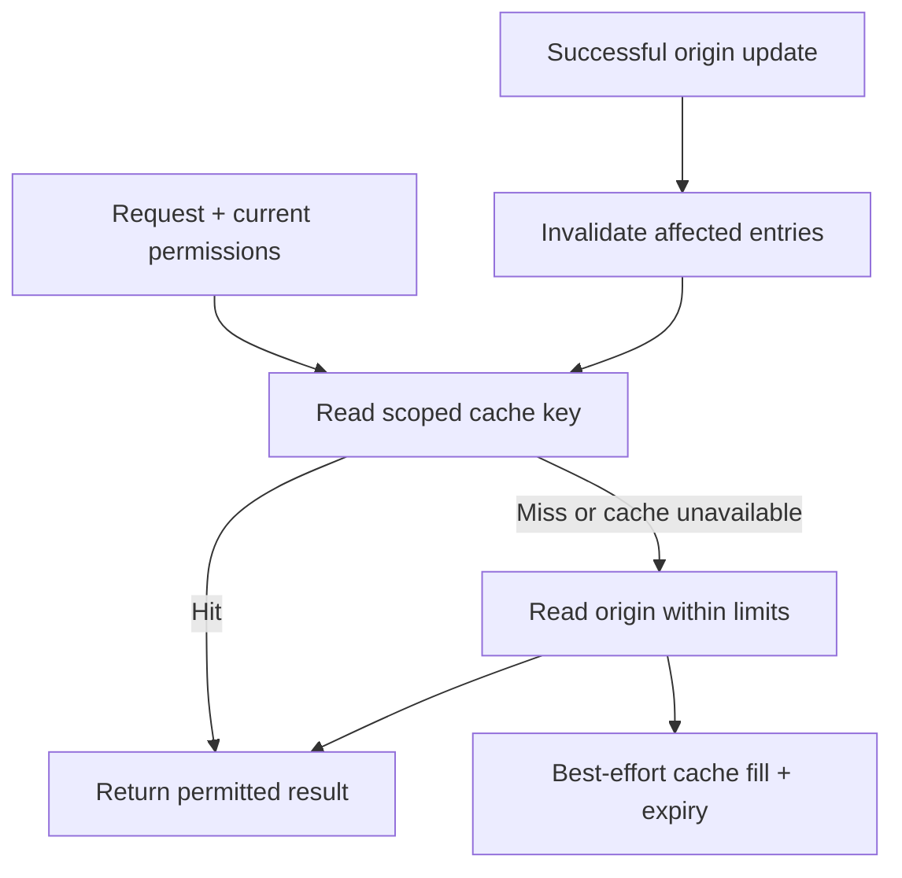

# Caching that fits the project

Use this guide for slow repeated reads, browser/CDN policies, Redis, cached UI data, or stale results after an update. First identify the expensive work and measure the uncached path. Follow the [database guide](database.md) for queries and indexes. A simple app can use one suitable database without an application data cache; a static website can benefit from HTTP caching without adding a backend.

## Choose the layer from the actual need

| Need | Starting point | Additional responsibility |
| --- | --- | --- |
| Public scripts, styles, fonts, and display images | Existing host/browser/CDN HTTP caching | Versioned URLs, correct response headers, and deployment refresh |
| Small app with acceptable response times | No application data cache | Keep measuring representative requests |
| Repeated expensive reads in one Rust process | Consider a bounded in-process cache such as [Moka](https://github.com/moka-rs/moka) | Capacity, expiry, and a separate copy in every process |
| Several instances benefit from shared cached results | Consider Redis or an existing suitable shared cache | Network failure, memory/eviction, access controls, and invalidation |
| Cached data in an interactive UI | Use the existing frontend's facilities when useful | Refresh after mutations, account changes, reconnect, and relevant server changes |

Multiple instances do not by themselves require Redis. Avoid adding a local cache in front of a shared cache until measurements justify two layers of invalidation. Durable offline records, queued writes, sessions, and rate-limit state have their own correctness requirements; do not treat them as freely disposable copies. Build caches and Git cleanup are separate concerns.

## Start with correct HTTP behavior

These are illustrative **response** policies, not one setting for every route. Check the actual host/CDN and framework behavior, including errors, redirects, authentication, and compression. See [HTTP caching](https://www.rfc-editor.org/rfc/rfc9111.html) and [immutable responses](https://www.rfc-editor.org/rfc/rfc8246.html).

Public assets whose content changes only by receiving a new URL, such as `/assets/app.<content-hash>.js`:

```http
Cache-Control: public, max-age=31536000, immutable
```

Keep old assets available during rollout/rollback; do not overwrite an immutable URL with new bytes. The year-long lifetime is appropriate only for that versioned public asset example. For HTML that should check for updates before reuse:

```http
Cache-Control: no-cache
ETag: "representation-version"
```

Generate the validator from the actual representation and handle conditional requests correctly. The example ETag is a placeholder, not a fixed value to reuse after changes. `no-cache` permits storage but requires successful validation before reuse. For sensitive responses that should not be stored:

```http
Cache-Control: no-store
```

`private` prevents shared-cache storage but still permits a browser's private cache; it is not equivalent to `no-store`. Neither header replaces authorization or erases copies already stored elsewhere. Do not apply public caching to personalized responses by default. Include relevant representation variations in cache keys/`Vary` and verify the CDN's rules; do not trust arbitrary request headers as permission or content identity.

Frontend query caches, service workers, and manually stored browser data need their own lifecycle review. Test logout, login as another user, and tenant switching for stale private data. Clear only the relevant disposable copies; preserve user-owned offline work. For uploaded images, follow the [image-upload guide](image-uploads.md): version display-copy URLs when bytes change and apply the original access/retention policy to cached derivatives too.

## Record a small cache decision

For each cached result, record its source of truth, the cost being avoided, and:

- **Identity and access:** key namespace/version, record ID, relevant query parameters, locale, and user/tenant scope. Authorize before serving private results; a tenant prefix is not authorization. Validate inputs and bound key and value sizes.
- **Freshness:** acceptable data age for this use, expiry, update/delete invalidation, and whether stale data is ever allowed. Recheck authoritative state for permission decisions or reservations that require current state.
- **Capacity:** memory/entry limits, eviction behavior, and maximum simultaneous work. An eviction target is not necessarily a strict process-memory ceiling; verify the library/server's semantics.
- **Failure:** request deadlines, connection/response timeouts, bounded retries, unavailable-origin behavior, and an owner for operational failures.
- **Evidence:** representative cold/warm latency, origin query counts/load, memory, errors, hits/misses, evictions, and correctness after changes. A high hit ratio alone is not success.

## Cache-aside and invalidation

The application reads the cache, loads the origin on a miss, and stores a temporary copy. After a successful origin write, invalidate or refresh affected entries, including lists and aggregates. See [cache-aside guidance](https://learn.microsoft.com/en-us/azure/architecture/patterns/cache-aside).



This diagram does not guarantee consistency. A read started before a write can refill the cache with old data after invalidation. An invalidation can also fail after a successful commit. Choose versioned entries, conditional refresh, reliable invalidation delivery, or authoritative reads according to the freshness requirement; test the chosen race behavior. A TTL starts when the entry is written and does not prove the source was current at that moment.

Avoid rolling back an already committed database change just because a cache operation failed. Report/observe the cache failure, retain the successful write, and handle stale copies according to the policy. Realtime invalidation is an optimization, not the only recovery path: reconnect and missed events must eventually refresh the view. Follow the [realtime guide](realtime.md).

When many requests miss together, coalesce refreshes for a key where useful, vary expiration times where appropriate, and cap concurrent origin work. A cache outage must not create unlimited database requests or retries. Serving stale content is acceptable only where the feature permits it; do not bypass security when the cache or authorization dependency is unavailable.

## Redis with Rust

Redis is an optional shared cache. Keep it private to intended application clients, restrict commands/key access with ACLs, and configure encrypted transport as appropriate. Never expose it directly to browsers or publish its port as an automatic deployment default. Follow [Redis security](https://redis.io/docs/latest/operate/oss_and_stack/management/security/) and Oracle's [security guide](security.md).

Set a memory budget and an eviction policy that fit the workload. For disposable cached copies, `allkeys-lru` is a reasonable candidate to evaluate; it is not a safe blanket policy for essential sessions or jobs. Expiry does not replace `maxmemory`, and `maxmemory` is not the entire container memory budget: allow headroom for overhead, buffers, and other work. Separate cache-only and essential state when their policies conflict. See [Redis eviction guidance](https://redis.io/docs/latest/develop/reference/eviction/).

Use a maintained client such as [redis-rs](https://redis.io/docs/latest/develop/clients/rust/). Reuse appropriate connections and set explicit connection, read/write or response timeouts. In an async server use the client's async facilities instead of blocking an executor thread; budget requests even when connections are multiplexed. Bound reconnect attempts and whole-request time, including name resolution and origin work. A client timeout does not necessarily cancel a command already sent to Redis.

Store the value and its expiry in one command, such as `SET key value PX milliseconds`, instead of separate `SET`/`EXPIRE` commands that can leave an immortal entry on partial failure. Choose the duration from the feature's freshness requirement. Treat unexpected cache contents and oversized values as a boundary to validate, and never log credentials or private values while debugging. See [SET semantics](https://redis.io/docs/latest/commands/set/).

## Runnable Rust/Redis example

The complete example is bundled offline: [Rust source](../assets/caching/main.rs), [manifest](../assets/caching/Cargo.toml.example), [lockfile](../assets/caching/Cargo.lock.example), [Dockerfile](../assets/caching/Dockerfile), [build-context ignore file](../assets/caching/Dockerfile.dockerignore), [Compose recipe](../assets/caching/compose.yaml), and [verification helper](../assets/caching/verify.py). It is independent of Oracle's Rust source and adds no Redis dependency to Oracle itself.

From the bundled `assets/caching/` directory, use Python 3.11+ on Unix and the intended local Docker engine with Buildx and Compose:

```sh
python3 verify.py
# Or select an existing Colima Docker context explicitly:
python3 verify.py --context colima
```

To run just the normal scenario directly with Compose, choose a project name unused by other workloads (`oracle-cache-demo` below is illustrative), and run from the same example directory:

```sh
docker compose -p oracle-cache-demo build demo
docker compose -p oracle-cache-demo up -d --wait redis
docker compose -p oracle-cache-demo run --rm --no-deps demo verify
docker compose -p oracle-cache-demo down
```

Use the same chosen project name for these commands; with Colima, use `docker --context colima compose ...` throughout. This manual path does not exercise the outage/restart scenarios; use the verifier for those.

Follow the [containerization guide](containerization.md) to verify context/profile, architecture, and runtime availability. Colima must use the Docker runtime for these commands. Starting or changing a shared VM remains a separate action within the user's scope. The helper rejects remote Docker endpoints, creates a uniquely named Compose project, and removes only that project's containers/network and its labeled demo image. It leaves shared base images and build cache alone.

The recipe builds the Rust client with tests, runs it without root, and starts a disposable Redis service on an internal network with **no published ports**. Redis uses temporary storage, persistence disabled, a 32 MiB cache budget, and a 128 MiB container limit. These are fixture settings, not measured production recommendations. The client disables optional features and uses plaintext within this isolated fixture; TLS requires the appropriate client features and configuration. The unauthenticated fixture is only for this isolated example; deployments need their own ACL, TLS, capacity, persistence, and network decisions. Supply reviewed base images/digests when controlling a release; defaults are maintained mutable tags.

Protected mode is disabled only in that disposable container fixture so its unauthenticated peer client can connect. A loopback health probe alone would not prove peer access. Keep protected mode and appropriate authentication for a deployed service; do not copy the fixture's access policy or publish its port. The verifier checks the runtime network is internal and Redis has no host port bindings or durable volumes.

For native verification, install Rust 1.88+ and Redis and run:

```sh
python3 verify.py --native
```

The helper materializes the manifest/lockfile templates in a temporary project, checks formatting/lints/tests, builds the client, and starts its own Redis process on a private Unix socket with TCP disabled. It stops only that process. Oracle's CLI still requires Rust 1.85+; this standalone example has its own pinned client and toolchain requirement.

Both modes exercise misses, hits, update invalidation, expiry, an already-established connection failing after Redis stops, startup with Redis unavailable, and a **new client** after restart. The example reuses one synchronous connection and disables it after the first failure during that short run. It does not implement a long-running reconnect loop. Only an exact key in a unique run namespace is deleted; no global flush/prune is used.

The origin is a small in-memory fixture with an artificial 25 ms read delay. Printed cold/warm timings are observations, not performance promises. Assertions verify returned values and origin-read counts. The sequential example does not establish database durability, tenant authorization, concurrent invalidation correctness, stampede protection, eviction under load, HTTP/CDN behavior, or production recovery. Test those against the actual application when relevant. Native Linux results also do not establish Colima's macOS VM behavior.

Use `TEST-001` for executed scenarios, advisory `PERF-001` for representative measurements, and applicable `SEC-002` evidence for private cached responses. The guide can be used without initialization or an active performance finding. It adds no required cache, service, schema fields, or release gates.
