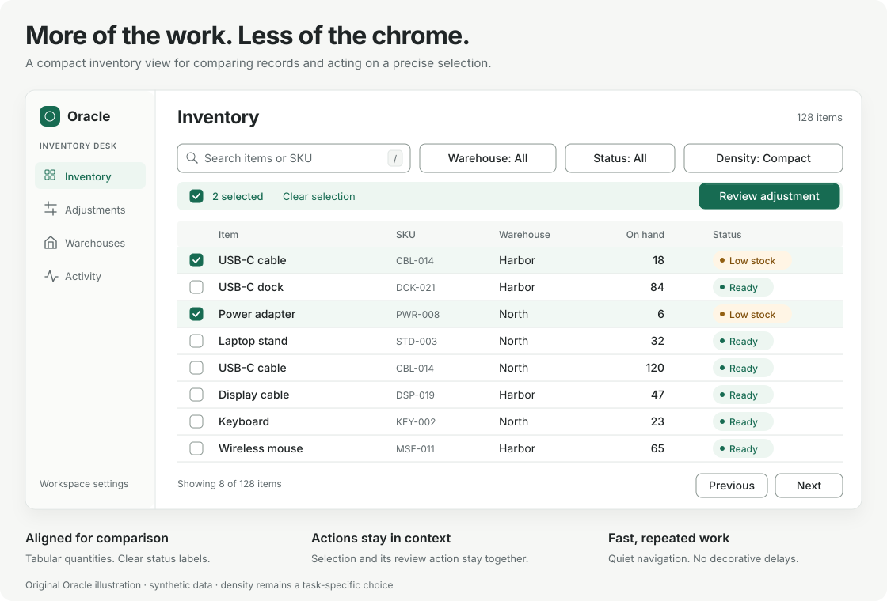
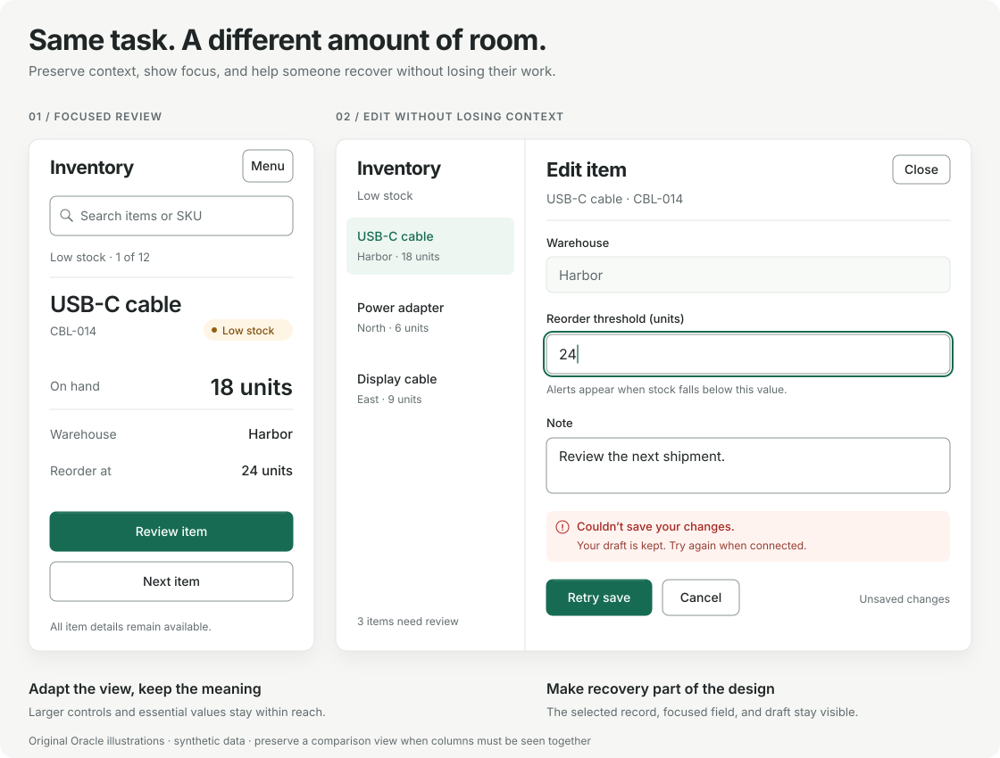

# Oracle compact UI guide

Help people see the information they need and complete their work with fewer unnecessary steps. For enterprise screens, begin with a compact workspace, then adjust it for the actual task, input method, and user preference.

This is Oracle's framework-independent guidance. It does not require a UI library, create new configuration fields, or impose pixel-based release gates. A comfortable or adaptive layout with a clear rationale is a valid choice. The illustrations use synthetic data and demonstrate layout intent; they are not interactive components or usability-test results.

## Begin with a task

Describe one primary workflow before choosing spacing. For example: **find low-stock items, compare quantities across warehouses, select two records, and prepare a stock adjustment**. Identify what must be visible together, what can wait until selection, and what needs confirmation before it changes data.

Record the intent using Oracle's existing specification:

```toml
[ux]
density = "adaptive"
primary_workflow = "Compare warehouse stock on desktop; review one item at a time on a phone."
rationale = "Compact rows support comparison; larger controls support touch and focused edits."
```

`UX-001` checks that the audience, density, workflow, and rationale are recorded. It does not grade the design. `UX-002` asks for a review of the implemented workflow when that card applies.

## Example 1: compare and act on desktop



The work area starts near the top of the screen. Search and filters sit next to the records they affect. Product names remain readable; quantities align for comparison. Selection has a visible count and a scoped action. Navigation is secondary to the table.

Use this pattern for repeated desktop comparison and batch work. Keep the most important columns visible and offer column selection when needed. A details panel can hold less frequently used fields. Large welcome banners or repeated summary cards earn their space only when they help the current task.

## Example 2: adapt the workflow and expose details



On a narrow screen, this task becomes a focused item review. Preserve the identifier, location, quantity, and next action. The desktop detail panel keeps the list context visible while someone edits one record. Labels remain above fields; save and cancel actions are explicit.

Choose this adaptation only when sequential review still supports the task. If comparing columns is essential, retain a labeled horizontally scrollable table or provide a comparison view; do not silently remove critical fields. Make omitted details available through a clear action. Keep destructive and bulk actions distinct from ordinary navigation.

## Layout decisions

| Area | Useful starting point | Adjust when |
| --- | --- | --- |
| Page structure | Short heading, relevant status, then the primary work area | Orientation or a complex decision needs more explanation |
| Navigation | Compact sidebar or top navigation with clear current location | Narrow screens need a labeled, keyboard-operable menu |
| Search and filters | One aligned toolbar; show active filters and a clear reset | Advanced filters need an expandable area or saved views |
| Records | Tables for comparison; lists for sequential review; align numbers and units | Relationships, timelines, or spatial tasks need another representation |
| Details | Reveal secondary fields on selection or in a dedicated view | The task requires several details visible side by side |
| Actions | Keep frequent actions near their subject; show selection scope | Destructive changes need a separate review or confirmation |

Reduce decorative padding and repeated containers before reducing text size. Use restrained borders, alignment, and grouping to establish hierarchy. Show status through text as well as color. Do not hide essential actions behind hover alone.

## Density is adjustable

For a desktop prototype, **32–36 CSS px single-line rows and controls, 14–16 CSS px primary text, and 12–16 CSS px work-area padding** are reasonable values to try. These are Oracle design suggestions, not accessibility thresholds or mandatory tokens. Allow rows and fields to grow for wrapped text, validation messages, localization, zoom, and user font settings. Avoid fixed heights that clip content.

Offer compact and comfortable settings where frequent use justifies the choice. Preserve the user's selection, and keep the same data and capabilities available. Touch-oriented layouts can start with larger controls, around 44 CSS px, while retaining a concise page structure. Adapt to available space and input capabilities rather than assuming that every small screen uses touch or every large screen uses a mouse.

Check targets individually: an icon's painted size is not its clickable area. WCAG 2.2's minimum pointer-target criterion is 24 × 24 CSS px with specified exceptions, including spacing; it applies beyond touch input. Larger targets can still be easier to use. Row height by itself cannot demonstrate compliance. See the [W3C target-size explanation](https://www.w3.org/WAI/WCAG22/Understanding/target-size-minimum.html).

Support keyboard access, visible focus, meaningful labels, sufficient contrast, and zoom. Reflow surrounding controls at narrow widths; a data table that genuinely needs two-dimensional layout may need its own scroll region. Preserve access to every relevant value and action. See [W3C reflow guidance](https://www.w3.org/WAI/WCAG22/Understanding/reflow.html).

## Review the implemented screen

At prototype stage, a focused review of one important task can be enough to guide the next iteration. Add broader coverage as real usage and release risk justify it. Do not turn these suggestions into a new mandatory checklist for every small edit.

For the inventory example, try finding low stock, comparing two warehouses, selecting the intended records, reviewing an adjustment, and recovering from a failed save. Use realistic row counts, long labels, empty results, loading, and an error state. Check the intended desktop viewport and a narrow view, plus keyboard navigation and zoom. A 1366 × 768 desktop and a 390 CSS px narrow view are useful examples, not required device sizes.

Record what was actually observed:

- Task, data scope, viewport, input method, and density setting.
- Whether important values can be compared and actions found; note unnecessary scrolling, ambiguous selections, and mistakes. Visible row count is context, not a score to maximize.
- Keyboard order, focus visibility, labels, target behavior, zoom/reflow, and access to details.
- Loading, empty, validation, and failure behavior; unresolved issues and untested cases.

Keep a short sanitized review in `.oracle/reports/ux-review.md`; screenshots may help explain observations. Record `UX-002` evidence only after performing the review, using `--result fail` when the criterion failed. Oracle verifies provenance and freshness, not the truth of a screenshot or report.

## Optional implementation references

Keep an effective existing frontend stack. These are examples for projects that need a component approach, not Oracle dependencies or default installation steps:

- [shadcn/ui and TanStack Table](https://ui.shadcn.com/docs/components/base/data-table): build a table around the application's sorting, filtering, selection, and layout requirements. Choose spacing deliberately and review the assembled behavior.
- [Ant Design theming](https://ant.design/docs/react/customize-theme/): its compact theme provides one starting point for component density. Adjust the complete page structure and workflow as well as component sizes.

The same layout reasoning applies to server-rendered HTML and other frontend frameworks. A Rust backend does not dictate the browser component system.
