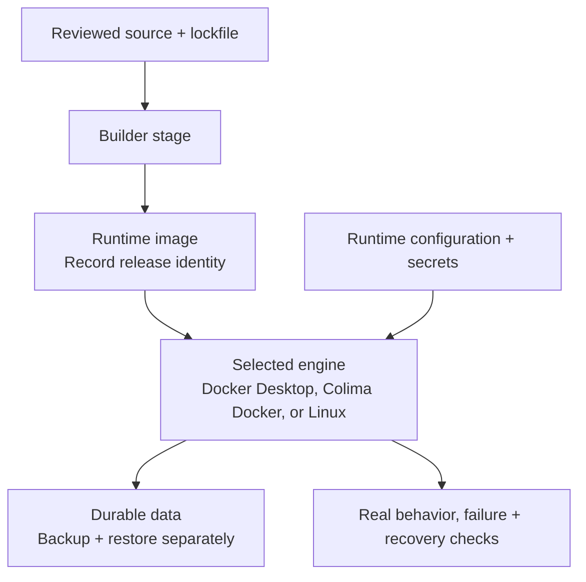

# Containerization that fits the project

Use this guide when packaging an application, choosing a local container runtime, or reviewing container deployment and recovery. A static host or native Rust binary can be sufficient. Add containers for a concrete benefit such as consistent runtime dependencies, repeatable deployment, or isolated local services. Keep an effective existing stack; Kubernetes is a separate operational choice, not a prerequisite.

## Choose the runtime and verify the target

An image packages an application and its runtime files. The container engine runs it; a CLI talks to that engine. On macOS, a Linux VM supplies the environment for Linux containers. Docker Desktop and Colima are local runtime options, not application architectures.

| Environment | Starting point |
| --- | --- |
| Docker Desktop | Use its Docker engine/context and verify the CLI, Buildx, and Compose plugin are available. |
| Colima on macOS or Linux | Select its Docker runtime to use these Docker CLI/Compose examples. Install the client tools separately as needed. Check the intended profile, VM resources, and shared paths. |
| Linux host or CI runner | A Docker Engine installation can run the examples directly; a desktop VM manager is not required. |
| Colima with containerd or another engine | Use that runtime's supported tooling and verify differences. A working `nerdctl` setup does not establish Docker CLI/Compose compatibility. |

Check the actual tools and daemon before diagnosing a project problem:

```sh
docker context ls
docker version
docker buildx version
docker compose version
```

Separate a missing executable, an unloaded PATH, an unavailable daemon, and the wrong context. A CLI version alone does not prove an engine is reachable. Check environment overrides such as `DOCKER_HOST` and `DOCKER_CONTEXT`; avoid changing a shared default context merely to run one task. See [Docker contexts](https://docs.docker.com/engine/manage-resources/contexts/).

For Colima, follow the current [installation](https://colima.run/docs/installation/) and [runtime documentation](https://colima.run/docs/runtimes/). A typical default-profile Docker setup is:

```sh
colima status
# If the intended profile is not running and starting it is in scope:
colima start --runtime docker --activate=false
docker context ls
docker --context colima version
docker --context colima compose version
```

Use the context shown for the chosen profile; named profiles may have different context names. The [start command's `--activate=false` option](https://colima.run/docs/commands/#runtime-flags) avoids switching the shared active context; use explicit Docker context arguments for subsequent build/run/Compose commands too. Reuse an existing compatible profile. Changing runtime/architecture, stopping a shared VM, or deleting its data can affect other projects. Missing Compose/Buildx plugins require client installation/configuration, not a different application Dockerfile. Check the [Colima FAQ](https://colima.run/docs/faq/) for plugin, socket, and mount troubleshooting. Do not use VM deletion or broad pruning as a routine repair.

Prefer the deployment's native architecture where practical. An Apple Silicon development image and an x86 server image need the appropriate `linux/arm64` and `linux/amd64` variants. Emulation or a successful cross-build does not establish native runtime behavior; test the final image on the intended platform. Set VM CPU, memory, disk, and shared directories to fit the workload rather than copying universal limits. See [multi-platform builds](https://docs.docker.com/build/building/multi-platform/).

## Build a small, maintainable image

Use a multi-stage build to separate compilers and build dependencies from runtime files. Build with the project's lockfile, a reviewed base image, and only the source required. Keep `.git`, local reports, credentials, uploads, dependency directories, and build output outside the build context. A root `.dockerignore` or a correctly placed Dockerfile-specific ignore file controls what reaches the builder; `.gitignore` does not replace it. See [build practices](https://docs.docker.com/build/building/best-practices/) and [build context rules](https://docs.docker.com/build/concepts/context/).

For Rust, verify the binary's target and runtime requirements: libc compatibility, native libraries, certificates, external commands, and required assets. `scratch` or Alpine is not automatically suitable for a binary built against another runtime. Test the final stage; passing tests in the builder cannot reveal missing runtime files. Measure image size and build time before adding elaborate cache stages.

Image tags can move. Pin reviewed base digests for controlled builds, maintain an update process, and record the resulting application image digest for deployment. A base digest plus a lockfile does not freeze separately downloaded OS packages. Build once and promote the tested artifact when reproducible release identity matters.

## Keep configuration, secrets, and data separate

Use the existing deployment's runtime configuration and secret facilities. Build credentials belong in [secret or SSH mounts](https://docs.docker.com/build/building/secrets/), not Dockerfile `ARG`, `ENV`, or copied files. Removing a secret in a later layer does not remove it from earlier layers. Secret mounts also require the build command not to copy or log their contents. Keep frontend public configuration distinct from server credentials; follow the [security guide](security.md).

Put databases, user uploads, and other required state in deliberate durable storage, outside the container's replaceable writable layer. Named volumes, bind mounts, and managed/object storage have different ownership and recovery responsibilities. With Colima or Docker Desktop, local named volumes generally live in the runtime's VM; they are not automatically host backups. Check VM sharing and permissions for bind mounts. [Volume persistence](https://docs.docker.com/engine/storage/volumes/) is not a tested backup or protection from host/VM loss.

Follow the [database guide](database.md) for restore and SQLite topology, and the [image-upload guide](image-uploads.md) for optimized copies and user-chosen original storage. Keep application data separate from build caches, image layers, and logs. Identify ownership and backups before removing containers or storage; commands such as `down -v`, volume pruning, or VM deletion can remove retained data. Cleanup should target only the task's disposable resources.

## Operate the application, not just its process

For a long-running service, distinguish running, ready to serve, and healthy. A startup dependency order alone is not readiness; [Compose health conditions](https://docs.docker.com/compose/how-tos/startup-order/) can wait for a dependency initially, while the application still needs bounded retry/reconnect after later failures. A Docker health status does not by itself restart an unhealthy container or prove that real requests succeed.

Use exec-form startup, handle termination signals, stop accepting new work, and drain bounded in-flight work before exit. Follow the [realtime guide](realtime.md) for WebSocket draining and recovery. A one-shot CLI should return its actual exit code instead of being kept alive with a restart loop or dummy health endpoint.

Run without root where practical, restrict capabilities, and use a read-only root filesystem with explicit writable mounts when compatible. Avoid privileged mode or Docker-socket mounts as routine fixes. Expose only necessary ports; in Compose, peers normally use service names and container ports, not another container's `localhost`. Keep databases on appropriate private networks. See [Compose networking](https://docs.docker.com/compose/how-tos/networking/).

Bound CPU, memory, process counts, temporary storage, and log retention based on measured needs. Test limits and failure recovery rather than assuming configuration was enforced. Give logs useful context without secrets, and route meaningful failures to an owner. Development source mounts and reload servers should not accidentally become the production configuration. Compose can suit a [single-server production deployment](https://docs.docker.com/compose/how-tos/production/); additional orchestration needs a demonstrated purpose.



## Runnable Rust and Compose examples

The bundled [Dockerfile](../assets/containerization/Dockerfile), [Dockerfile.dockerignore](../assets/containerization/Dockerfile.dockerignore), and [compose.yaml](../assets/containerization/compose.yaml) package Oracle itself. They demonstrate a real Rust CLI without introducing a demo server or database. Adapt the principles to an application's own source, runtime, storage, and health behavior.

Run these commands **from an Oracle source checkout**, with Docker Engine/Buildx and the Compose plugin available. The installed skill alone contains the recipes, not Oracle's Rust source. Confirm the selected engine is the intended local development environment; use `docker --context colima ...` for a Colima Docker profile when appropriate.

```sh
docker build --pull \
  -f skills/oracle/assets/containerization/Dockerfile \
  -t oracle-guide:local .
docker run --rm --network none oracle-guide:local --version

# Disposable project for the example, inside the checkout's shared directory.
mkdir -p .oracle
export ORACLE_PROJECT_PATH="$(mktemp -d "$PWD/.oracle/container-example.XXXXXX")"
export ORACLE_UID="$(id -u)"
export ORACLE_GID="$(id -g)"
docker compose -f skills/oracle/assets/containerization/compose.yaml config --quiet
docker compose -f skills/oracle/assets/containerization/compose.yaml run --rm oracle \
  init --name container-example --kind cli --audience developer
docker compose -f skills/oracle/assets/containerization/compose.yaml run --rm oracle assess
```

Each invocation creates a new container; `oracle.toml` and local reports persist in `ORACLE_PROJECT_PATH`. The example requires a non-root host user on Unix for matching file ownership; use a deliberate non-root UID/GID with writable mount permissions elsewhere. It publishes no ports and disables runtime networking. Only the build downloads dependencies. Its read-only root, writable project mount, and sample resource limits are specific to this CLI, not universal service defaults.

The default base tags track maintained releases; supply reviewed digest references through `RUST_IMAGE` and `RUNTIME_IMAGE` build arguments for controlled builds. Keep the ignore file beside the Dockerfile. On Colima, ensure the checkout is shared into the VM before mounting it. Do not change global Git ownership checks to hide a UID mismatch. Bind-mounted `.git` metadata must also be accessible; linked Git worktrees may refer to paths outside the mounted directory and require a suitable isolated checkout.

With Python 3.11+ and Git on the host, from the source checkout, `python3 tests/container_smoke.py` builds and exercises the final image and Compose recipe in a disposable project. Use `--context colima` for that local Docker context. It verifies CLI behavior, Git inspection, non-root execution, file ownership, persistence across containers, and an actual rejected write to the read-only root. It does not test a web service's readiness, shutdown, backup restore, or rollback. Run only against a local engine whose bind mounts can access the checkout; the helper refuses remote endpoints. It removes only its own containers and image tag, leaving shared base images and build cache alone.

## Verify the deployment and recovery scope

For the application's actual deployment, record the engine/runtime, architecture, image identity, configuration, and the behavior exercised. Confirm required data survives container replacement; separately test restore into an isolated destination. For services, exercise a real request, a dependency failure, readiness, and graceful shutdown. Test rollback or forward recovery with migration compatibility accounted for; replacing an image does not undo a database migration.

Reuse `TEST-001` for executed behavior and applicable `OPS-001`, `OPS-002`, and `DATA-002` evidence. Native Linux container checks do not establish Colima VM, macOS sharing, or another architecture's behavior. Configuration parsing, image builds, and live runtime checks are distinct evidence. This guide adds no container requirement, schema fields, engine dependency, or automatic deployment to Oracle.
