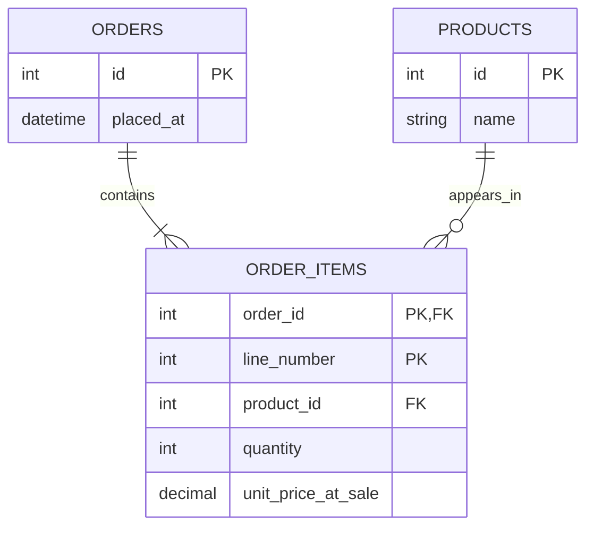

# Database design and performance

Use this guide when an app persists records, shares data, or has slow data access. Start with the main reads and writes, who owns each record, and what must remain true after a change. A simple app can have a sound schema without a distributed data platform.

## Start with the smallest suitable storage

| Need | Starting point | Reconsider when |
| --- | --- | --- |
| Public content or a stateless calculator | Source files, static assets, or no persistence | Users need durable editable records or shared state |
| Local data or a small app on one server | SQLite on durable local storage, when its concurrency model fits | Writes contend or several servers need direct access to shared data |
| Shared data across application instances | An existing suitable database, or a client/server database such as PostgreSQL | Measurements justify additional infrastructure |

SQLite can serve websites as well as local apps; traffic alone is not the decision. Consider write concurrency, storage durability, and deployment topology. Avoid placing an SQLite file on an ephemeral deployment filesystem or sharing it across hosts as though it were a database server. See [SQLite's deployment guidance](https://www.sqlite.org/whentouse.html). Keep an effective existing database; Rust preference does not mandate a storage migration.

For a small app, begin with one database, a few tables, versioned migrations, and no application data cache. A short script may use one connection. A concurrent server using a client/server database can start with a small shared driver pool. A separate pooler, Redis service, read replica, or sharding scheme needs a concrete reason.

## Design around records and invariants

List the entities, relationships, ownership boundaries, and main queries before choosing tables. Decide which values are required, which combinations must be unique, what deletion means, and which changes must succeed together. Use primary keys, foreign keys, `NOT NULL`, uniqueness, and check constraints where they express those rules. Transactions protect related writes; application validation still provides useful errors and authorization. See [PostgreSQL's constraint guide](https://www.postgresql.org/docs/current/ddl-constraints.html).

Keep private records scoped to their owner or tenant on every read and write. A foreign key establishes a relationship, not permission to access it. Use parameterized queries, choose types that match the domain, and keep multi-step writes atomic. For SQLite, explicitly enable and verify foreign-key enforcement for each connection before transactions; do not rely on a driver or build default. See [SQLite's foreign-key setting](https://www.sqlite.org/pragma.html#pragma_foreign_keys).

Keep migrations in version control. Test both a fresh database and an upgrade from a representative prior schema, including invalid existing values and the recovery path. Prefer compatible changes when old and new app versions overlap. A reverse migration that drops new data is not a sufficient recovery plan. Use disposable data and describe what was actually exercised.

## Normalize enough to prevent conflicting facts

Use the first three normal forms as a practical starting point: avoid repeating groups; make non-key attributes depend on the whole candidate key; and avoid storing facts that depend on another non-key attribute. This reduces update anomalies. It is a design aid, not a requirement to split every value into its own table. See [Microsoft's normalization primer](https://learn.microsoft.com/en-us/previous-versions/troubleshoot/microsoft-365/microsoft-365-apps/access/database-normalization-description).

For example, an order should reference products through line items rather than have `product_1`, `product_2`, or a comma-separated product list:

This is a conceptual example, not a complete commerce schema. `unit_price_at_sale` is a historical fact about the line item, so later catalog-price changes must not overwrite it. Denormalize other facts only for an identified benefit, with a clear source of truth and update/rebuild strategy. JSON is useful for suitable document-shaped data; avoid hiding relationships or fields that need constraints and frequent queries inside an opaque blob.

## Index actual queries

Start with indexes required by keys and uniqueness. Then examine the important filters, joins, sorting, and pagination on representative data. For a query filtering tasks by `project_id` and ordering by `created_at`, a composite index on those columns is a candidate to measure, not a universal prescription. Choose column order to fit the query and engine; do not index every column or duplicate existing indexes. Each index consumes space and adds write work. See [PostgreSQL's index guide](https://www.postgresql.org/docs/current/indexes.html).

Review query plans and compare timings before and after a change. Fix unnecessary queries, repeated per-row fetches, and unbounded result sets too. A table scan can be appropriate for a small table. PostgreSQL does not automatically index the referencing side of a foreign key; evaluate those lookups and delete/update paths explicitly. See [foreign-key indexing behavior](https://www.postgresql.org/docs/current/ddl-constraints.html#DDL-CONSTRAINTS-FK).

`EXPLAIN ANALYZE` executes the statement, including side effects. Use an authorized disposable environment for write experiments and bounded load tests; an ordinary estimated plan is different from a measured run. Record engine version, data scale, query shape, plan, and observed timing without private values. See [PostgreSQL's EXPLAIN guidance](https://www.postgresql.org/docs/current/using-explain.html).

## Bound connections before increasing concurrency

For a concurrent Rust service, evaluate the chosen driver's shared pool; [SQLx's pool](https://docs.rs/sqlx/latest/sqlx/struct.Pool.html) is one option. Create a pool once per process and database configuration, then share it across handlers. Do not create a new pool per request or hold a database connection for the lifetime of a WebSocket. Verify the selected library version and deployment's connection limits.

Budget connections across all application instances, workers, and deployment overlap, leaving database capacity for administration and migrations. For example, three processes capped at five connections can use fifteen connections before other clients are counted. Set bounded acquisition waits and query/transaction timeouts; keep transactions short and release connections before unrelated network calls. Measure pool wait time, active connections, slow queries, and timeouts before raising limits. A pool limits connections, not the number of waiting requests: bound application concurrency too.

SQLite's concurrency needs different treatment: more connections do not create more concurrent writers. WAL allows readers and a writer to overlap, but still permits only one writer at a time and requires the same host. Use short writes and deliberate busy-timeout handling; enable WAL only when it suits the deployment. See [SQLite's WAL documentation](https://www.sqlite.org/wal.html). A separate connection proxy is an optional deployment choice, not a prerequisite for a small app.

## Cache only an identified expensive read

First measure the uncached path and improve the query. If caching helps, define the acceptable stale interval, cache key and user/tenant scope, size bound, expiry, and update/delete invalidation. A small bounded in-process cache may suffice; several instances introduce separate cache copies and invalidation concerns. Cache-aside does not guarantee consistency with the database. See [Microsoft's cache-aside guidance](https://learn.microsoft.com/en-us/azure/architecture/patterns/cache-aside).

Keep durable records in the database. Invalidate or refresh cached views after a successful commit, and test concurrent read/write races; a TTL limits ordinary staleness but does not provide immediate consistency. For decisions that require current state, such as authorization or stock reservation, check the authoritative path. Cache keys alone are not authorization. Account for expiry bursts, failed refreshes, cache outages, and database overload during fallback; bound retries and concurrent rebuilds.

Skip a cache when its invalidation cost exceeds the saved work. If realtime events refresh cached views, use the [realtime guide](realtime.md): a lost event must not leave a view stale forever. Static asset caching is a separate concern from caching private application records.

## Review and record proportionate evidence

For a small app, begin with a few representative save/read/update/delete scenarios, rejected invalid data, an upgrade from the prior schema, and a short recovery note. Add measurements when investigating slowness; test pool saturation or cache invalidation when those mechanisms are used. Production databases still need a demonstrated backup restore even when the app is small.

Use existing cards: `DATA-001` for schema, normalization, migrations, and relevant index review; `DATA-002` for restore; `PERF-001` for query/pool/cache measurements; `TEST-001` for executed behavior; and `SEC-002` for private-record authorization. Document intentionally omitted infrastructure and untested cases without claiming a pass for unperformed work.

Set `data.database = true` when the application uses a database, including a managed service. Set privacy flags from actual behavior. Record the storage rationale in `stack.rationale`; there are no new pooling or caching configuration fields. The source repository's `examples/simple-data/oracle.toml` is a small reading-list specification, not a runnable database. Oracle bundles this guide offline; it does not inspect a live schema, execute SQL, tune pools, or verify a cache.
