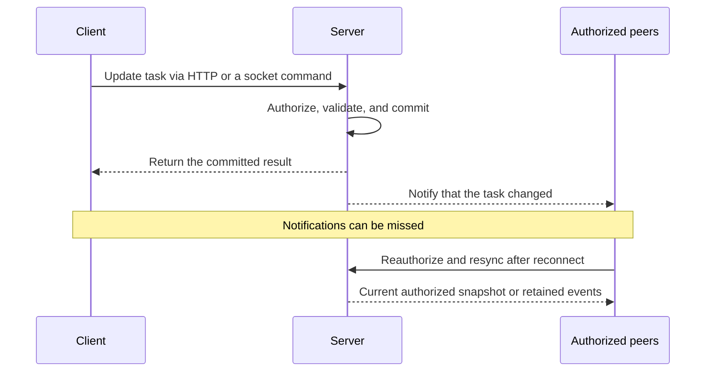

# Realtime features with WebSockets and Socket.IO

Use realtime delivery when freshness changes what people can do: chat, presence, collaboration, job progress, notifications, or live operational status. First describe the feature's acceptable delay, traffic direction, expected connections, and behavior when the connection disappears. A static page or occasional update may need no persistent connection.

This is implementation guidance for the application being built. Oracle remains an offline CLI: it does not open sockets, install these libraries, or verify a running realtime service. Use the existing specification and evidence cards; this guide adds no mandatory gates.

## Choose the smallest suitable transport

| Approach | Useful when | Trade-off |
| --- | --- | --- |
| HTTP refresh or polling | Updates are occasional and a short delay is acceptable | Simple request flow; choose a reasonable interval and pause unnecessary polling |
| Server-sent events (SSE) | The server streams updates to a browser, while writes can use HTTP | One-way event stream; still design authentication, reconnect, and resynchronization |
| Native WebSocket | Frequent two-way messages need a persistent connection | Define the message protocol, reconnect, authorization, limits, and recovery behavior |
| Socket.IO | Event-based interaction benefits from rooms, acknowledgements, automatic reconnection, and transport fallback | Requires compatible Socket.IO clients and servers, plus application-level recovery and authorization |

SSE is a practical candidate for progress and status streams; see [MDN's SSE guide](https://developer.mozilla.org/en-US/docs/Web/API/Server-sent_events/Using_server-sent_events). Chat and shared interactive workspaces can justify WebSocket or Socket.IO. Choose from the actual interaction; a live dashboard does not automatically require a two-way socket.

**Socket.IO is not the plain WebSocket protocol.** Its packets add a protocol layer. A native `WebSocket` client cannot talk directly to a Socket.IO endpoint, and `socket.io-client` cannot talk directly to a plain WebSocket endpoint. Using Socket.IO with WebSocket-only transport does not remove that layer. See the [Socket.IO introduction](https://socket.io/docs/v4/).

## Keep Rust in consideration

For a new Rust service, evaluate [Axum's WebSocket support](https://docs.rs/axum/latest/axum/extract/ws/index.html) for native WebSockets. When Socket.IO's features fit the task, evaluate [Socketioxide](https://docs.rs/socketioxide/latest/socketioxide/), a Rust Socket.IO server implementation for the Tower/Tokio ecosystem.

Verify the exact client/server protocol versions, transport options, middleware, adapters, and recovery features before adopting a pair. Socketioxide is a separate implementation; do not assume that every JavaScript Socket.IO option or adapter exists in Rust. Lock the selected application dependencies and test the intended pairing. Keep an effective existing stack, or document a justified alternative when a required feature is unavailable. These libraries are candidates, not dependencies bundled with Oracle.

## Define events and authoritative state

For a shared task board, a mutation changes server-owned state; an event lets other authorized clients refresh their view:

Give messages explicit names and schemas. Include identifiers, schema versions, and record revisions where useful. Distinguish temporary signals such as typing or presence from durable actions such as sending a message or editing a record. A room is a routing group, not an authorization boundary. Collaborative editing also needs a conflict-resolution model; a transport alone does not resolve concurrent edits.

For state notifications, fetch initial state and resynchronize on reconnect. Reconcile changes that race with the initial snapshot using revisions or a buffered subscription. If notifications may be lost, provide an appropriate refresh path while still connected, such as focus or periodic refresh. Show connecting, offline, retrying, and stale states honestly; a connected socket does not prove the displayed data is current.

## Reconnection is not guaranteed delivery

Socket.IO preserves ordering on a connection for events that arrive, but its default delivery guarantee is **at most once**. An acknowledgement means what the application's handler defines; it is not automatically evidence of a database commit. Retries can duplicate an action. See [Socket.IO delivery guarantees](https://socket.io/docs/v4/delivery-guarantees/).

Choose recovery per feature. Snapshot refresh may be sufficient for a status display. Durable messages may need event IDs, retention, replay cursors, and deduplication. Make retried mutations idempotent and acknowledge success after the required state change succeeds. Where losing a committed event is unacceptable, consider a transactional outbox or another durable publication design; emitting after a write alone leaves a crash gap.

Use bounded retries with backoff and jitter. Do not queue unlimited offline commands. Check server and adapter support before enabling Socket.IO connection-state recovery, and handle recovery failure with a fresh authorized synchronization. Recovery is not always successful even when enabled. See [connection-state recovery](https://socket.io/docs/v4/connection-state-recovery/).

## Protect connections and messages

Use TLS in deployed environments. Authenticate private connections, authorize each subscription and sensitive message, and derive permitted rooms from server-side access checks. Handle logout, session expiry, revoked permissions, and reauthorization on reconnect or recovery; restored room membership must not restore revoked access. Validate message shapes and sizes, limit rates and connection counts, and define a bounded send queue or slow-consumer policy. Keep credentials and private payloads out of logs. See [OWASP's WebSocket guidance](https://cheatsheetseries.owasp.org/cheatsheets/WebSocket_Security_Cheat_Sheet.html).

For browser clients, validate origins according to the application's policy, especially with cookie authentication. CORS configuration alone does not protect a WebSocket endpoint: Socket.IO's CORS handling applies to browser HTTP long-polling. Origin checks also do not replace authentication for non-browser clients. See [Socket.IO's CORS caveats](https://socket.io/docs/v4/handling-cors/).

## Deploy and scale when the workload needs it

Confirm that the chosen host and reverse proxy support the selected long-lived connections. Align heartbeat and idle timeouts, test reconnect during a restart, and drain connections during deployment. Measure concurrent clients, message rate, payload size, event latency, queue growth, reconnect rate, and memory before adding infrastructure.

With multiple Socket.IO servers, HTTP long-polling needs session affinity to keep a session on its owning process. WebSocket-only transport removes that polling requirement but sacrifices fallback. Cross-server room broadcasts still need a compatible adapter or shared distribution mechanism. Check recovery support for that adapter separately; a broadcast adapter is not automatically durable event storage. Start with one process when it meets the need. See [Socket.IO multi-node deployment](https://socket.io/docs/v4/using-multiple-nodes/).

## Review the behavior and record evidence

Start with one event and two test clients. Add coverage as the feature and release stage require it:

- Demonstrate the intended update and a clear committed result; verify that an unauthorized user cannot receive or mutate another user's records.
- Disconnect a client, change server state, and reconnect. Check missed updates, duplicate commands, and stale-state recovery. Include logout or revoked access during the disconnect.
- Exercise invalid or oversized messages and a slow consumer in an authorized test environment. Confirm bounded queues and useful errors.
- Test the real proxy and configured transports, including fallback when enabled. If deploying several processes, put clients on different processes and verify scoped delivery and recovery.

Record exact dependency versions, transport settings, commands or steps, environment, observed outcomes, and untested cases. Map findings to existing cards: `STACK-001` for the decision, `TEST-001` for behavioral evidence, `SEC-002` for private-record authorization, `UX-002` for connection states, and `OPS-001` / `OPS-002` / `PERF-001` for applicable deployment, monitoring, and measurements. Declaring Socket.IO in a specification does not establish that any of these behaviors work.

In `oracle.toml`, describe the protocol choice and rationale in `stack.language` / `stack.rationale`, the live user journey in `ux.primary_workflow`, and the actual data features under `data`. V1 has no `[realtime]` table or automatic transport detection. Oracle's source repository includes `examples/realtime/oracle.toml`, a private task-board specification rather than a runnable server. Save sanitized review artifacts under `.oracle/reports/` and record only work actually performed.
