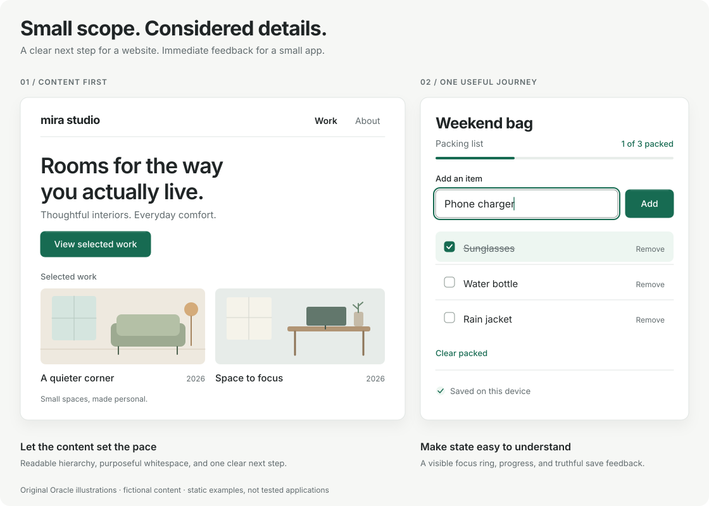

# Simple websites and small apps

Start with something useful that a person can understand and use. A portfolio, local-business page, event site, calculator, or personal tracker usually needs a clear purpose, readable content, and a short working journey. Keep the scope small enough to finish and improve from actual use.

This guide is advisory and works with any frontend stack. It adds no rules, dependencies, or release gates. For screens centered on comparing records and repeating actions, use the [compact UI guide](compact-ui.md). A product can use both approaches on different screens.

## Two small starting points

These are layout illustrations with fictional content, not templates, interactive apps, or usability-test results.

| Project | First useful version | Check the real journey |
| --- | --- | --- |
| Website | Explain who or what it is for, show relevant content, and give visitors a clear next step | Can a visitor understand the offer, find the information, and follow the main link on a phone? |
| Small app | Make one task work from input to useful result; add supporting features as needed | Can someone complete the task, correct a mistake, and understand what happens to their data? |

For the illustrated portfolio, the journey is introduction → selected work → project detail. For the packing list, it is add an item → mark it packed → correct or remove it. If the app saves data, decide whether that means this session, this device, or an account, and test the promised behavior after a reload.

## Design with purpose and personality

- Write the real heading, content, and action labels before filling the page with sections. A primary action can be a navigation link, a calculator's result action, or a form submission; secondary actions can still be available.
- Use whitespace to separate ideas and support reading. Choose comfortable or adaptive spacing when it fits. A landing page can be spacious; a small app can be compact. Avoid forcing either into a dashboard layout.
- Choose a coherent visual direction through typography, color, and useful imagery. Build sections around the content instead of adding a generic hero, feature grid, testimonials, or pricing table to every site. Use real claims and assets you have permission to publish.
- Make layouts work across the intended screen sizes. Keep essential content and actions reachable, allow text to wrap and zoom, and keep images proportionate. See [MDN's responsive-design guidance](https://developer.mozilla.org/en-US/docs/Learn_web_development/Core/CSS_layout/Responsive_Design).
- Use descriptive links, native buttons, labeled inputs, meaningful headings, visible keyboard focus, and useful image alternatives. See [MDN's semantic HTML guidance](https://developer.mozilla.org/en-US/docs/Learn_web_development/Core/Accessibility/HTML).

## Keep the implementation proportional

A static site can start with HTML, CSS, and the JavaScript its interactions need. Keep an effective framework or site generator when it helps the project; there is no required stack. Consider Rust first when a new service or tool is actually needed. Do not introduce a backend solely to satisfy a language preference.

Add accounts when identity or shared private data is part of the feature. Add a database when the persistence and query needs justify one. Add caching, containers, and scaling machinery in response to deployment needs or measured problems. A form may need a service or a provider even when the rest of the site is static; browser code must not contain private credentials.

Keep only used source and assets in the project. Size images for their use, remove unused starter sections and dependencies when safe, and keep generated output out of Git. A small scope still needs truthful behavior: a contact form must actually deliver or clearly report failure; a save indicator must reflect persistence; a payment or booking flow needs the safeguards its real consequences require.

## Use Oracle lightly

Use `project.kind = "web-app"` for websites and browser apps in v1; this label does not require a server. Choose the actual audience and release stage. `consumer` describes an audience, not a promise that the app is simple. Record a short rationale in the existing `stack` and `ux` fields. Set the `data` flags from real behavior, including any external services, rather than assuming a small project has no sensitive data.

At prototype stage, focus on the main journey and relevant repository findings. When sharing a beta or publishing, advance the stage and review the relevant release work. `oracle check` remains advisory; strict enforcement is opt-in. Database and authorization cards apply when the declared data features need them. A static site's deployment review can cover publishing, verifying the URL, and restoring the previous version; monitoring can begin with a proportionate availability check.

## Review enough to trust the main journey

Try the primary action on the intended desktop and narrow-screen layouts, with keyboard navigation and zoom. Check the actual links, inputs, outputs, and relevant loading, empty, success, and failure states. Test data persistence if promised. For a static page, a focused link and layout review may be more useful than a large application test suite; use the project's build command when it has one.

Before publishing, verify the deployed URL and main action, correct page title and content, missing assets, and the absence of private data in public files. Keep the review proportional to the features and their consequences. Do not claim payment, privacy, security, or accessibility assurance from a quick visual check.

When recording `UX-002` or `TEST-001` evidence, describe the steps actually performed, their outcome, and untested cases in a short sanitized report under `.oracle/reports/`. Oracle checks provenance and freshness; the report remains a supplied attestation.
